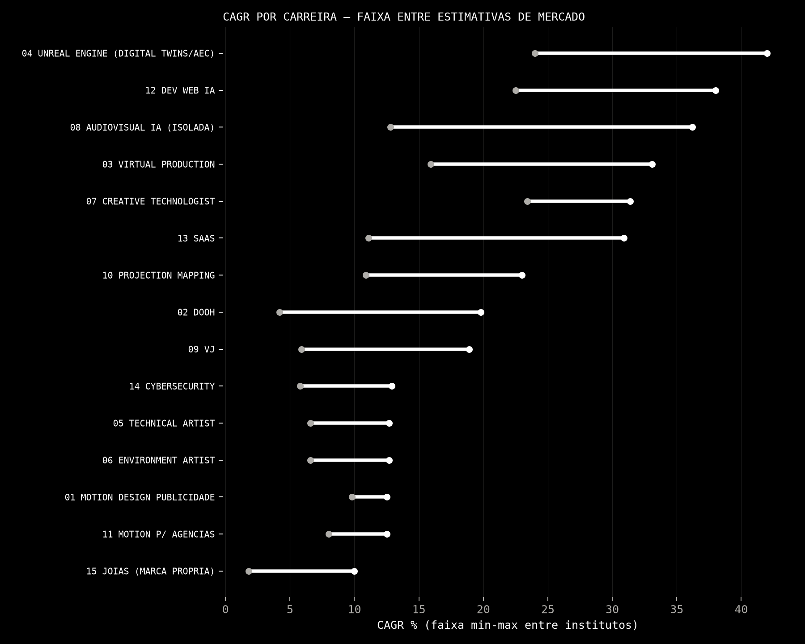
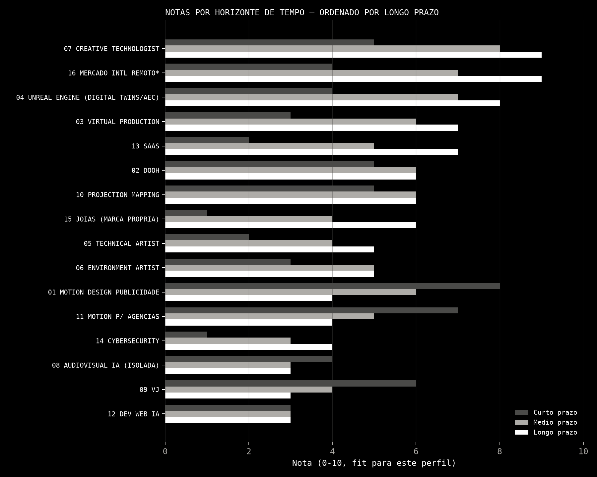
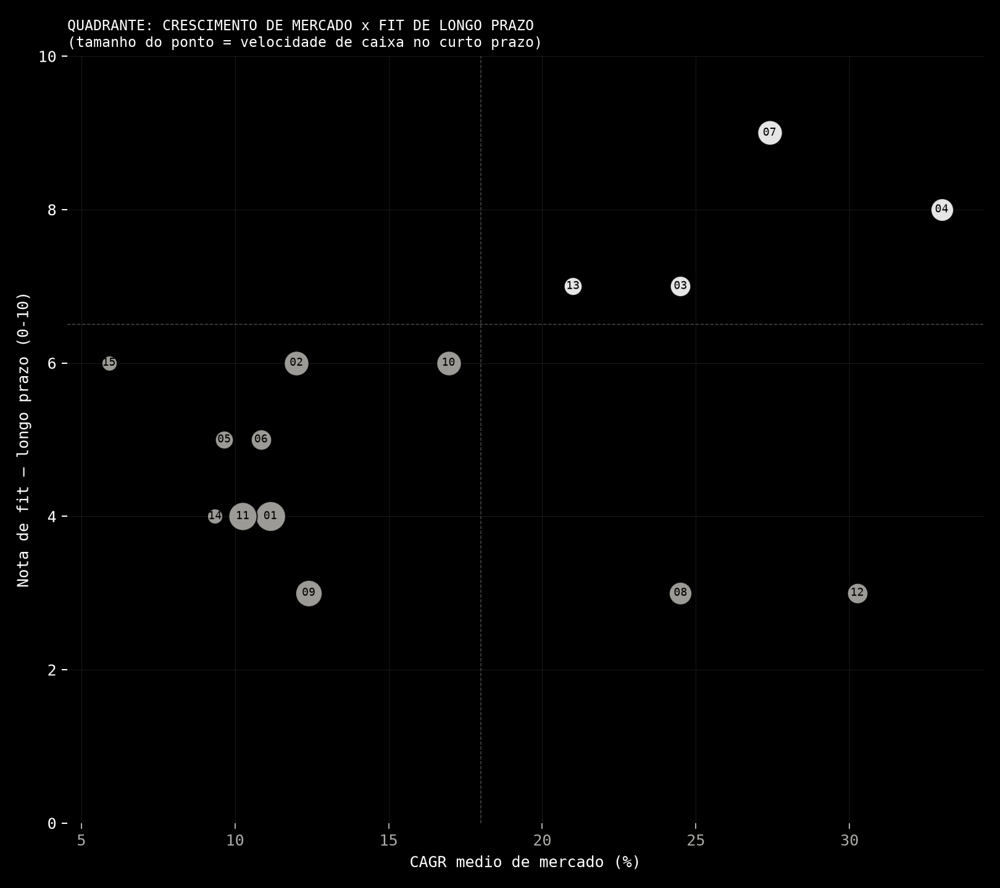

# Relatório Estratégico de Carreira — Economia Criativa, Real-Time & IA
### Gyulyia · 2026–2035 · Nível consultoria (McKinsey/Bain/BCG/Deloitte style)

**Data-base:** julho/2026. **Metodologia:** pesquisa via WebSearch em fontes primárias/institucionais (IBGE, Sebrae, PwC, McKinsey, Gartner, Grand View Research, Fortune Business Insights, MarketsandMarkets, Mordor Intelligence, Glassdoor, LinkedIn, Epic Games, Adobe, Nvidia, GDC/SIGGRAPH, Meio & Mensagem, WEF), executada por 4 agentes de pesquisa paralelos (124 buscas no total). Todo número tem `[Fonte, Ano]`. Onde os institutos divergem, todas as estimativas aparecem lado a lado — **não escolhemos uma "verdade" artificial**. Onde nada confiável foi achado: `dado não encontrado`, nunca inventado.

**Perfil considerado:** brasileiro(a), home office, autonomia, sozinho/estúdio pequeno, quer abrir empresa, não quer depender só de indicação, sem formação em programação, sem ComfyUI/Python, não quer graduação longa. Meta de renda: R$8k → R$15k → R$20k → R$30k+/mês. Já domina: After Effects, Unreal (básico/intermediário), IA generativa (Kling/Nano Banana/Runway), Resolume (básico).

**Regra de desempate:** sempre que "melhor mercado teórico" ≠ "melhor mercado para este perfil", vence o segundo.

**Material complementar:**
- Mapa interativo (quadrante crescimento × fit, hover/tabela): https://claude.ai/code/artifact/316b59ad-d7e0-4eb8-8434-fad4cd055009
- Versão executiva no Canva (resumo + rankings + 3 estratégias): https://www.canva.com/d/FYGrUf2br5A-NGt (editável: https://www.canva.com/d/kClhcqjczdKI8nj) — sem brand kit "Gyulyia" cadastrado no Canva desta conta; design gerado replicando manualmente a identidade do site (preto/branco, mono, uppercase).
- Gráficos estáticos: `assets/cagr_ranges.png`, `assets/notas_horizonte.png`, `assets/quadrante_crescimento_fit.png`

---

## Sumário executivo (leia isto primeiro)

O perfil já carrega ativos raros e difíceis de replicar: motion + real-time (Unreal) + IA generativa + VJ/live visuals — uma combinação horizontal que poucos profissionais brasileiros têm simultaneamente. A pesquisa aponta 3 achados centrais:

1. **A commoditização por IA é real e já mensurável — mas desigual.** Dev Web/vibe coding e motion design "puro" (execução, não direção) são as categorias com evidência quantitativa mais forte de deslocamento (WEF 2025 lista design gráfico como 11ª ocupação em declínio mais rápido; emprego júnior em dev caiu 20–60% nos EUA 2022–2025). Já Creative Technologist, Digital Twins/arquitetura via Unreal, virtual production e negócios com produto físico (joias) aparecem nas fontes como **beneficiários**, não vítimas, da mesma onda.
2. **O maior gap do mercado brasileiro não é falta de demanda, é falta de dado.** VJ, projection mapping, DOOH criativo e virtual production não têm dimensionamento de mercado próprio no Brasil — só proxies (eventos, publicidade, audiovisual geral). Isso não significa mercado pequeno; significa mercado imaturo/informal, o que favorece quem entra cedo e profissionaliza.
3. **O caminho de maior probabilidade de sucesso não é uma única carreira, é uma pilha (stack) de 3 camadas**: (a) motion/DOOH/projection mapping como motor de caixa de curto prazo (skill já pronta, ciclo de venda curto), (b) Creative Technologist + Unreal (arquitetura/digital twins/experiências) como motor de crescimento de médio prazo, (c) internacionalização remota (dólar) como multiplicador estrutural de longo prazo. IA generativa entra como **ferramenta de alavancagem em todas as camadas**, não como profissão isolada — a pesquisa não encontrou reconhecimento formal de "AI Video Artist" como cargo (WEF Future of Jobs 2025 não lista a ocupação).

Recomendação de fundo: **Estratégia Balanceada** (seção final) é a que melhor respeita a regra de desempate perfil > mercado ideal.

---

# PARTE 1 — As 16 carreiras

Cada carreira responde às 39 perguntas do briefing em formato compacto. Legenda de notas: 0–10, sendo 10 = ideal para ESTE perfil especificamente (não nota "objetiva" de mercado).

---

## 1. Motion Design para Publicidade

**O que faz / dor que resolve / quem paga:** cria motion graphics 2D/3D, branded content, product visualization para campanhas; resolve o problema de "transformar mensagem de marca em conteúdo que retém atenção". Pagam: agências, produtoras, marcas in-house, plataformas de streaming/social.

**Mercado Global:** forte divergência conforme escopo — US$18,4bi (2025)→US$55,14bi/2034, CAGR 11,6% [Vantage Market Research, 2025] **vs.** US$85,5bi(2024)→US$98,3bi(2025)→US$280bi/2034 [Custom Market Insights, 2025] — diferença de >5x pela definição de escopo.
**Mercado BR:** sem relatório dedicado; proxy = Audiovisual Brasil R$70,2bi/2024, 608.970 empregos [Min. Cultura/IBGE, 2024/25]; Indústria Criativa R$393,3bi/2023 (3,59% do PIB) [IBGE, 2025]. Publicidade total BR: US$15,7bi/2024 (+8%) [Statista, 2025].
**CAGR:** 11,6%–12,2% nas fontes mais consistentes.
**Tam. 2030/2035:** sem consenso; horizonte usual dos relatórios é 2033/34 (US$55–280bi, ver acima). 2035 global: dado não encontrado.
**Salário CLT:** júnior R$2.000–3.500; pleno R$4.000–7.000; sênior R$8.000–12.000 [Glassdoor BR, 2025]. **PJ:** sênior R$12.000+/mês; freelance ~R$200/h [Glassdoor BR, 2025]. **Freelancer intl (Upwork):** mediana US$25/h (US$18–35) [Upwork, 2026]. **Exterior CLT (EUA):** média US$94.597/ano; sênior US$118.289/ano [Glassdoor US, 2026].
**Tempo até R$8k/mês:** 6–12 meses (skill já dominada — só falta portfólio/clientes). **Até R$20k/mês:** 2–4 anos (via PJ + clientes internacionais). **Potencial >R$50k/mês:** possível só combinando PJ nacional + clientes em dólar + direção de estúdio; nicho.
**Barreiras de entrada:** baixas (software acessível, portfólio já existente no perfil). **Dificuldade técnica:** baixa-média (já domina). **Networking:** médio-alto (agências compram por relação). **Risco de automação IA:** **alto** — WEF 2025 lista design gráfico como 11ª ocupação com declínio mais rápido nos próximos 5 anos [WEF Future of Jobs, jan/2025]; TAG estima 204 mil posições afetadas nos EUA [Animation Guild, 2024].
**Skills que resistem à IA:** direção de arte, storytelling, relação com cliente, curadoria/julgamento estético — execução pura (renderização, montagem) é a parte mais automatizável.
**Empresas BR:** MonkeyBusiness, Studio PO, Retina Studio, True Motion Studios [Behance/institucional, 2025]. **Intl:** referências de mercado amplamente reconhecidas (Buck, Giant Ant) não confirmadas nesta pesquisa — citar com ressalva.
**Softwares:** After Effects, Cinema 4D, Blender, Premiere, Houdini. **Hard skills:** animação, composição, 3D básico, direção de arte. **Soft skills:** prazo, briefing, apresentação de conceito.
**Referências BR:** Studio PO (Jonathas Alpoim, Rafael Neves), Retina Studio. **Casos intl:** dado não encontrado nesta pesquisa.
**SWOT:** F: skill já pronta, ciclo de venda curto. O: publicidade digital BR crescendo 8-10%/ano [IAB Brasil, 2025]. W: commoditização, teto salarial doméstico baixo. T: WEF classifica como risco alto de IA.
**Porter:** rivalidade **alta** (mercado saturado); novos entrantes **muito alta** (barreira caindo com IA); poder do comprador **alto** (agência escolhe entre dezenas); substitutos **alto** (IA generativa); fornecedores (software) **baixo**.
**BCG:** **Vaca leiteira em erosão** — gera caixa hoje, mas cresce pouco e perde margem para IA.
**Riscos principais:** compressão de preço por ferramentas de IA acessíveis a todos. **Oportunidades:** quem "pilota IA" em vez de temê-la aumenta produtividade e pode cobrar por direção, não por hora de render.
**Qualidade de vida:** média-alta (prazos apertados de agência). **Remoto:** alto. **Liberdade:** alta em PJ. **Abrir empresa:** fácil (estúdio pequeno). **Escalabilidade:** baixa-média (limitada por horas, a menos que vire estúdio com equipe).
**Nota:** curto **8** / médio **6** / longo **4** — ótima porta de entrada e caixa, mas não é onde construir os próximos 10 anos sozinho.

---

## 2. DOOH (Digital Out Of Home)

**O que faz / dor que resolve / quem paga:** cria conteúdo (inclui anamórfico/naked-eye 3D) para painéis LED/fachadas/retail media; resolve "converter tráfego físico em atenção de marca". Pagam: anunciantes via agências de mídia, ou diretamente operadoras (Eletromidia, Helloo, JCDecaux).
**Mercado Global:** US$20,7bi(2024)→US$26,5bi(2026)→US$39,1bi/2030, CAGR 10,7% [Grand View Research, 2025]. Programático isolado: US$7,5bi(2024)→US$45,8bi/2034, CAGR 19,8% [market.us, 2025].
**Mercado BR:** divergência forte — US$481,55mi/2025 (CAGR 4,16%) vs. ~US$1,5bi/2024 (CAGR ~7%) [fontes de mercado não bem atribuídas, 2025]. LatAm US$2,7bi/2024, BR >1/3 do total regional. Programático BR: 25%→35% das campanhas até 2026, +70% investimento 2024→2025 [World Out of Home Org./Meio&Mensagem, 2025]. Eletromidia: >80% market share BR, 66 mil painéis, alcance mensal >53 milhões pessoas.
**CAGR:** global 10,7%; programático 19,8%; BR 4,16%–7% (divergente).
**Tam. 2030:** US$39,1bi global [GVR, 2025]. **2035:** divergente — US$56,8bi a US$88,64bi conforme fonte [agregadores, 2025/26] — tratar com cautela (não é fonte tier-1).
**Salário CLT:** sem CBO específico; proxy Gerente de Mídia Digital R$11.104/mês, em agência top (AlmapBBDO) R$14.000/mês [Glassdoor BR, 2025/26]. Conteúdo criativo DOOH tende a seguir faixa de motion design (ver carreira 1). **PJ/freelance:** dado não encontrado especificamente. **Exterior:** dado não encontrado.
**Tempo até R$8k/mês:** 8–14 meses (precisa portfólio anamórfico + relação com 1-2 operadoras/agências). **Até R$20k/mês:** 3–5 anos. **Potencial >R$50k/mês:** só como estúdio fornecedor recorrente de operadora grande.
**Barreiras de entrada:** médias (exige aprender técnica anamórfica/naked-eye, não é After Effects padrão). **Dificuldade técnica:** média. **Networking:** alto (relação direta com operadoras/agências de mídia é decisiva). **Risco de automação IA:** dado quantificado não encontrado para a parte criativa; a automação encontrada é do lado de compra de mídia (programática), não do conteúdo.
**Skills que resistem à IA:** domínio técnico de óptica/perspectiva para anamórfico, relação comercial com operadoras.
**Empresas BR:** Eletromidia (líder absoluto), Helloo, LED Expert, Go Cities. **Intl:** JCDecaux (€3,935bi receita 2024), Lamar Advertising (US$2,16bi), Clear Channel Outdoor, Ströer.
**Softwares:** After Effects, Cinema 4D, TouchDesigner/Notch (conteúdo real-time). **Hard skills:** motion 3D, perspectiva/anamorfismo, specs técnicas de painel. **Soft skills:** venda B2B, relacionamento com mídia.
**Referências BR:** dado não encontrado (nenhum profissional individual identificado nesta pesquisa). **Casos intl:** JCDecaux "Deep Motion" (tecnologia proprietária de profundidade).
**SWOT:** F: nicho menos saturado que motion genérico, ativos já dominados (motion+3D) transferem direto. O: programático crescendo forte, retail media em expansão. W: dados de mercado BR fracos/informais. T: dependência de poucos players concentrados (Eletromidia domina 80%).
**Porter:** rivalidade **média** (menos players especializados que motion genérico); novos entrantes **média**; poder do comprador **alto** (operadoras concentradas); substitutos **médio**; fornecedores **baixo**.
**BCG:** **Interrogação** — mercado crescendo bem, mas posição do freelancer individual ainda pequena/não consolidada.
**Riscos:** dependência de poucos clientes-operadora. **Oportunidades:** anamórfico é uma skill de nicho técnico que poucos motion designers dominam — diferenciação real.
**Qualidade de vida:** boa (menos prazos "de social media" frenéticos). **Remoto:** alto para criação, presencial pontual para instalação/calibração. **Liberdade:** alta em PJ. **Abrir empresa:** viável como estúdio fornecedor. **Escalabilidade:** média (mais projetos de ticket alto, não volume).
**Nota:** curto **5** / médio **6** / longo **6** — bom complemento de nicho ao motion genérico, não substituto.

---

## 3. Virtual Production

**O que faz / dor que resolve / quem paga:** produção com câmera virtual + LED volume + Unreal Engine (nDisplay/ICVFX), captando VFX in-camera; resolve "filmar em qualquer lugar sem viagem/set físico caro". Pagam: estúdios de cinema/streaming/TV, agências (comerciais), produtoras de eventos.
**Mercado Global:** divergência relevante entre líderes — US$2,10bi(2025)→US$8,76bi/2030, CAGR 33,1% [MarketsandMarkets, 2025] **vs.** US$2,8bi(2025)→US$12,3bi/2033, CAGR 20,4% [Grand View Research, 2025] (revisado para cima frente a estimativa anterior da mesma casa, US$6,78bi/2030).
**Mercado BR:** dado numérico não encontrado; evidência qualitativa forte: Globo inaugurou o **maior volume LED da América Latina** (1.500m², 300m² de LED 16K HDR, dez/2024), já em uso na novela "Volta por Cima" [TELA VIVA/TecMundo, 2024]; O2 Filmes + 555 Studios trouxeram a tecnologia "definitivamente" ao Brasil [Propmark, 2024/25].
**CAGR:** 20,4%–33,1% (entre as maiores desta pesquisa). Segmento EUA: 15,9%(2024-30); América do Norte 16,5%.
**Tam. 2030:** US$8,76bi [MarketsandMarkets]. **2033:** US$12,3bi [GVR]. **2035:** dado não encontrado.
**Salário CLT/PJ BR:** dado não encontrado (função nova demais para aparecer em Glassdoor/Catho BR). **Exterior (EUA):** Real-time 3D Artist média US$72.980/ano; Unreal Engine Artist US$65.873/ano (faixa US$50.269–86.641) [Glassdoor US, 2026]; Technical Artist c/ Unreal US$82.286/ano [PayScale, 2026]; operador LED volume por hora ~US$26,15/h [ZipRecruiter, 2026].
**Tempo até R$8k/mês:** 1,5–3 anos (exige acesso a volume LED, geralmente via emprego/contrato em estúdio, não solo). **Até R$20k/mês:** 4–6 anos. **Potencial >R$50k/mês:** alto só em posição sênior/liderança técnica em operação como Globo/O2 Filmes, ou consultoria internacional.
**Barreiras de entrada:** **altas** — equipamento (LED volume) é caro, inacessível para trabalho solo em casa; via de regra exige contratação por estúdio. **Dificuldade técnica:** média-alta (nDisplay, tracking, calibração). **Networking:** alto (poucos players, comunidade pequena). **Risco de automação IA:** baixo — fontes tratam a área como **beneficiária** da IA (DLSS, neural rendering aceleram, não substituem) [Nvidia, 2025/26].
**Skills que resistem à IA:** operação de pipeline complexo, resolução de problemas em tempo real no set, coordenação entre departamentos (isso é logística+técnica, difícil de automatizar).
**Empresas BR:** Estúdios Globo, O2 Filmes + 555 Studios, On+AV. **Intl:** ILM/StageCraft (5 volumes: LA, Pinewood, Vancouver — Mandalorian, Ahsoka), NEP Virtual Studios/Lux Machina (Trilith Studios), Pixomondo.
**Softwares:** Unreal Engine, nDisplay, Mo-Sys/Stype (tracking), Brompton/Disguise (processamento LED). **Hard skills:** Unreal avançado, sincronização de câmera, calibração de cor. **Soft skills:** trabalho em equipe grande, comunicação sob pressão de set.
**Referências BR:** Sérgio Silva (Epic Games Training Partner, SP), Tony Cruz (CEO Goblin Studios, instrutor certificado Epic Games) [Behance/Goblin School, 2025/26]. **Casos intl:** The Mandalorian/Ahsoka (ILM StageCraft).
**SWOT:** F: alinhamento direto com Unreal já dominado. O: maior CAGR do estudo inteiro entre carreiras "clássicas". W: exige capital/infraestrutura fora do alcance solo. T: concentração em poucos estúdios grandes (dependência de emprego, não autonomia).
**Porter:** rivalidade **baixa** (poucos players especializados no Brasil); novos entrantes **baixa** (barreira de capital alta); poder do comprador **alto** (poucos estúdios grandes compram); substitutos **baixo**; fornecedores de equipamento **alto poder**.
**BCG:** **Estrela** — mercado de altíssimo crescimento, mas exige posição/capital para capturar valor (não é nicho solo-friendly).
**Riscos:** sem acesso a volume LED, fica-se de fora; exige emprego CLT/PJ em estúdio, contraria preferência por autonomia total. **Oportunidades:** virar especialista freelance em "conteúdo Unreal para virtual production" (ambientes/assets), sem precisar operar o volume fisicamente.
**Qualidade de vida:** média (sets têm horas longas). **Remoto:** baixo-médio (parte pode ser remota — criação de ambientes — parte exige presença). **Liberdade:** baixa-média no papel de operador; alta se atuar como fornecedor remoto de assets/ambientes. **Abrir empresa:** difícil sozinho (capital); viável como estúdio de conteúdo para volumes de terceiros. **Escalabilidade:** média.
**Nota:** curto **3** / médio **6** / longo **7** — não como operador solo; sim como fornecedor remoto de conteúdo Unreal para volumes de terceiros.

---

## 4. Unreal Engine — por segmento

**O que faz / quem paga:** motor real-time multi-indústria. Pagadores variam totalmente por segmento — publishers de jogos, estúdios de cinema, escritórios de arquitetura/incorporadoras, indústrias (digital twins), empresas de treinamento, marcas (XR).
**Mercado Global (game engines, todos os usos):** US$3,45bi(2024)→US$12,84bi/2033, CAGR 17,85% [Astute Analytica, 2025] vs. US$3,87bi(2026)→US$10,34bi/2034, CAGR 13,1% [Fortune Business Insights, 2025/26].
**Qual segmento cresce mais (comparação direta):** **Digital Twins** e o bloco "Others"/não-gaming (arquitetura, defesa, produção de mídia) lideram — CAGR de 24% a >40% conforme fonte [Fortune Business Insights; Global Market Insights; Grand View Research, 2025], muito acima de games tradicional (13-18%) e simulação militar (7,85%). Educação/saúde cruzada com game engines: 29%/ano [FBI, 2025]. AEC domina 37,2% da receita de digital twins.
**Mercado BR:** dado não encontrado por segmento; evidência qualitativa: comunidade de arquitetura adotando Unreal via SPBIM/DVIZ; 43 vagas Unreal Engine ativas no LinkedIn Brasil no momento da busca.
**Tam. 2030/2035:** ver acima — Digital Twins global US$328,5–428,1bi até 2033/34 (duas fontes, CAGR 31–42%) — dos maiores números de todo o relatório.
**Salário CLT BR:** Dev Unreal Engine média R$5.166/mês (faixa R$2.161–7.274) [Glassdoor BR, 2026]; Game Dev pleno R$8.200/mês, sênior R$11.450+ [agregado, 2025]. **PJ:** até 35% acima de CLT [fonte contábil, 2025]. **Exterior:** Unreal Engine Artist US$65.873/ano; Technical Artist c/ Unreal US$82.286/ano [Glassdoor/PayScale US, 2026]; UK £24.138/ano [PayScale UK, 2026].
**Tempo até R$8k/mês:** 1–2 anos (especializando em arquitetura/twinmotion, que já usa habilidade de motion+3D). **Até R$20k/mês:** 3–5 anos (clientes internacionais de AEC/digital twins). **Potencial >R$50k/mês:** alto em consultoria internacional de digital twin industrial ou arch-viz de ponta.
**Barreiras de entrada:** médias (curva Unreal já iniciada no perfil; Blueprints reduz necessidade de código puro). **Dificuldade técnica:** média (sem programação profunda dá para atuar em arch-viz/twinmotion; Technical Artist puro exigiria mais). **Networking:** médio (escritórios de arquitetura, incorporadoras). **Risco de automação IA:** baixo — segmento visto como beneficiário (renderização acelerada por IA), não ameaçado.
**Skills que resistem à IA:** integração de pipelines (BIM→Unreal), julgamento de apresentação/storytelling arquitetônico, otimização de performance.
**Empresas BR:** Goblin Studios, SPBIM, DVIZ. **Intl:** Epic Games, Autodesk (3ds Max 2026 c/ Unreal 5.3), Twinmotion (produto Epic p/ AEC).
**Softwares:** Unreal Engine 5, Twinmotion, Quixel Megascans, integração BIM. **Hard skills:** Blueprints, iluminação/Lumen, otimização de cena. **Soft skills:** apresentação a clientes não-técnicos (arquitetos, incorporadoras).
**Referências BR:** Sérgio Silva, Tony Cruz (mesmos da carreira 3). **Casos intl:** dado não encontrado especificamente para arch-viz.
**SWOT:** F: skill já em construção no perfil, Blueprints evita programação pesada. O: segmento de maior crescimento entre TODAS as 16 carreiras pesquisadas (Digital Twins). W: mercado BR pouco mapeado/nichado. T: concorrência de arquitetos que aprendem Unreal sozinhos.
**Porter:** rivalidade **baixa-média**; novos entrantes **média**; poder do comprador **médio** (incorporadoras/escritórios); substitutos **baixo** (Twinmotion/Unreal difícil de substituir por V-Ray tradicional em tempo real); fornecedores **baixo** (Epic Games é gratuito até certo faturamento).
**BCG:** **Estrela** — maior CAGR do relatório inteiro no segmento Digital Twins/AEC.
**Riscos:** nicho ainda pequeno no Brasil, exige evangelizar clientes tradicionais (V-Ray/Corona) a migrar para real-time. **Oportunidades:** ser um dos primeiros especialistas brasileiros em "Unreal para arquitetura" tem efeito de escassez.
**Qualidade de vida:** alta (trabalho de estúdio, sem sets físicos). **Remoto:** alto. **Liberdade:** alta. **Abrir empresa:** sim, natural (estúdio de visualização). **Escalabilidade:** média-alta (pode formar equipe/treinar outros).
**Nota:** curto **4** / médio **7** / longo **8** — a aposta de maior crescimento estrutural do relatório, mas precisa de 12-24 meses de especialização deliberada.

---

## 5. Technical Artist

**O que faz / quem paga:** híbrido arte+engenharia — shaders, materiais, sistemas procedurais, rigs, ferramentas de pipeline, otimização em Unreal/Unity. Pagam: estúdios de jogos, cada vez mais produtoras de virtual production/publicidade/arquitetura.
**Mercado:** sem mercado próprio — proxy games global US$298,98bi/2024 [GVR, 2025]; virtual production US$1,52bi(2024)→US$8,76bi/2030 CAGR 33,1% [MarketsandMarkets, 2025]; 3D Digital Asset Market US$28,3bi(2024)→US$51,8bi/2029 CAGR 12,9% [MarketsandMarkets, 2024].
**CAGR games:** 12,2%(GVR)–12,68%(Mordor)–6,58%(Statista) — divergência relevante.
**Tam. 2030:** games US$593–746bi conforme fonte. **2035:** US$777bi–US$1,08tri (dispersão grande entre 5 institutos).
**Salário CLT BR:** média R$7.000/mês (faixa R$2.834–11.184) [Glassdoor BR, 2025]. **Offshore/contrato intl:** US$12.000–48.000/ano [Qubit Labs, 2025]. **Exterior CLT (EUA):** média US$107.800/ano — entrada US$80.776, lead US$115.521, sênior US$154.866, principal US$235.296 [Glassdoor US, 2026]. **Freelancer intl:** US$80–150/h, podendo passar US$200k/ano [GameIndustryCareerGuide, 2025/26].
**Tempo até R$8k/mês:** 2–3 anos (exige aprender scripting/Blueprints avançado, shaders — fora do conforto atual do perfil). **Até R$20k/mês:** 5+ anos. **Potencial >R$50k/mês:** alto, mas só via mercado internacional sênior.
**Barreiras de entrada:** **altas** — exige lógica de programação/shader (o perfil evita Python; Blueprints ajuda mas Technical Artist sênior frequentemente pede scripting real). **Dificuldade técnica:** alta. **Networking:** médio (comunidade de estúdios). **Risco de automação IA:** GDC 2025 — 64% dos profissionais de arte técnica têm visão desfavorável da IA generativa, maior ceticismo entre todas as funções pesquisadas [GDC, 2025]; tarefas repetitivas de pipeline são as mais automatizáveis.
**Skills que resistem à IA:** arquitetura de pipeline, controle de qualidade, resolução de bugs complexos entre departamentos.
**Empresas BR:** Aquiris Game Studio (adquirida pela Epic Games em 2023 — 1º estúdio Epic na América Latina), QuByte Interactive. **Intl:** Epic Games, Riot Games, EA, Blizzard, Ubisoft, Rockstar.
**Softwares:** Unreal (Blueprints/Material Editor/Niagara), Houdini, Substance Designer, Python/MEL, Perforce/Git. **Hard skills:** shaders, scripting, otimização de performance. **Soft skills:** comunicação entre arte e engenharia.
**Referências BR:** dado não encontrado (indivíduo nomeado). **Casos intl:** Aquiris/Epic Games (aquisição de estúdio, não indivíduo).
**SWOT:** F: ponte natural do Unreal já conhecido. O: escassez de talento sênior pressiona salário para cima. W: exige exatamente a habilidade que o perfil quer evitar (scripting/Python-like). T: 64% de ceticismo do próprio setor sobre IA generativa cria instabilidade cultural na função.
**Porter:** rivalidade **média**; novos entrantes **baixa** (barreira técnica alta protege quem já está dentro); poder do comprador **alto** (poucos estúdios grandes); substitutos **médio** (IA fazendo parte do trabalho repetitivo); fornecedores **baixo**.
**BCG:** **Interrogação** — mercado atrativo, mas fit de habilidade do perfil é fraco sem investimento pesado em aprender scripting.
**Riscos:** curva de aprendizado technical vai contra a preferência explícita do perfil por evitar programação. **Oportunidades:** só compensa se houver apetite real de aprender Blueprints/HLSL a fundo.
**Qualidade de vida:** média (prazos de estúdio). **Remoto:** alto (muitos estúdios contratam remoto). **Liberdade:** média (geralmente CLT/contrato de estúdio, menos solo). **Abrir empresa:** difícil como TA puro (mais fácil como consultoria de pipeline). **Escalabilidade:** média.
**Nota:** curto **2** / médio **4** / longo **5** — mercado bom, fit de perfil ruim; não é onde investir sem antes topar aprender scripting a sério.

---

## 6. Environment Artist

**O que faz / quem paga:** constrói ambientes/mundos (level art, world building, modular environment) usando fotogrametria (Megascans), Nanite, Lumen. Pagam: estúdios AAA/indie, crescentemente arquitetura/virtual production.
**Mercado (proxy games):** global US$298,98bi/2024 [GVR]; **BR** R$12,7bi/2025 (+8%) [CartaCapital, 2025]; estúdios de desenvolvimento no Brasil: 1.042 em 2024 (+695% desde 2014); profissionais em criação/produção de jogos BR: 13.225 (2023) vs. 1.278 (2014), alta de +1.000% [Pesquisa Game Brasil/ABRAGAMES, 2024].
**CAGR:** 12,2%–12,68%–6,58% (mesma divergência de games, ver carreira 5).
**Tam. 2030:** BR US$5bi+ até 2030 (partindo de US$2,8bi em 2026) [Pesquisa Game Brasil, 2024]; global US$593–746bi. **2035:** global US$777bi–US$1,08tri.
**Salário CLT BR:** CBO adjacente "Designer de Games" média R$5.513/mês [salario.com.br, 2026]; amostras específicas de Environment Artist no Glassdoor BR têm N muito baixo e valores atípicos — tratar com cautela. 40–17 vagas abertas (Environment/3D Environment Artist) no Brasil [Glassdoor BR, 2025]. **PJ:** dado não encontrado. **Exterior (EUA):** média US$87.770/ano (faixa US$65.828–120.266); Rockstar US$77-130k, Epic Games US$74-129k; sênior em Riot/Blizzard/Epic US$110-150k base, total comp até US$220k [ArtBlast Salary Guide, 2025].
**Tempo até R$8k/mês:** 1,5–3 anos (via freelance internacional em plataformas de arte de games). **Até R$20k/mês:** 4–6 anos, majoritariamente via mercado internacional. **Potencial >R$50k/mês:** raro, exige posição lead/principal em estúdio AAA internacional.
**Barreiras de entrada:** médias-altas (portfólio precisa nível AAA para competir globalmente). **Dificuldade técnica:** média. **Networking:** médio (portfólio público pesa mais que rede pessoal, via ArtStation). **Risco de automação IA:** tarefas repetitivas (modelagem básica, texturização) são as mais expostas; Megascans/Nanite já reduzem parte do trabalho manual [Ikarus3D/NbyIT, 2025]. GDC 2025: mesmo grupo de 64% de ceticismo (arte visual/técnica).
**Skills que resistem à IA:** direção de arte de ambiente, composição de cena, curadoria de assets (vs. geração pura).
**Empresas BR:** Aquiris, QuByte Interactive. **Intl:** Epic Games, Rockstar, Riot Games, Blizzard, Ubisoft.
**Softwares:** Unreal (Nanite/Lumen/World Partition), Quixel Megascans, World Machine, Houdini, ZBrush, Substance 3D, SpeedTree. **Hard skills:** modelagem, texturização PBR, composição de nível. **Soft skills:** colaboração com level design/narrativa.
**Referências BR:** **Ander Alencar** — artista 3D brasileiro reconhecido internacionalmente, jurado do CGArchitect 3D Awards [Jornal de Brasília, 2025]; **Pedro Conti** — animador brasileiro com trabalhos para Disney/Marvel/Universal/Paramount (mais animação/character que environment puro) [Domestika/PixelShow, 2025]. **Casos intl:** citados acima (Rockstar, Epic).
**SWOT:** F: existe caminho de referência brasileira de sucesso internacional (Ander Alencar). O: setor de jogos BR cresceu +1.000% em profissionais em 10 anos. W: portfólio-padrão AAA é um investimento de tempo alto antes do primeiro cliente pagante. T: geração procedural via IA reduzindo trabalho manual repetitivo.
**Porter:** rivalidade **alta** (mercado global saturado de portfólios ArtStation); novos entrantes **alta**; poder do comprador **alto**; substitutos **médio** (IA em texturização); fornecedores **baixo**.
**BCG:** **Vaca leiteira em potencial** para quem já tem 2-3 anos de portfólio — não para quem começa do zero agora.
**Riscos:** ciclo longo até o primeiro cliente internacional pagante. **Oportunidades:** demanda cross-setorial (arquitetura/virtual production) para quem sabe ambientar cenas, não só games.
**Qualidade de vida:** média (crunch é real em estúdios AAA). **Remoto:** alto (portfólio é a carta de entrada). **Liberdade:** média (geralmente contrato de estúdio). **Abrir empresa:** difícil solo, mais fácil coletivo. **Escalabilidade:** média.
**Nota:** curto **3** / médio **5** / longo **5** — via legítima mas de ciclo longo, mais indicada se surgir interesse específico em direção artística de ambientes 3D.

---

## 7. Creative Technologist

**O que faz / quem paga:** funde programação criativa, design de interação, sensores/computer vision e engines real-time em instalações, campanhas experienciais, exposições e live experiences. Pagam: agências (labs de inovação), produtoras de eventos, museus/instituições, marcas.
**Mercado (proxies, sem estatística própria):** Immersive Marketing US$6,90bi(2024)→US$29,68bi/2030 CAGR 28,6% [GVR, 2025]; Events & Experiential Marketing US$1,897bi(2024)→US$9,29bi/2030 CAGR 31,4% [GVR, 2025]; Immersive Entertainment US$144,17bi(2025)→US$412,69bi/2030 CAGR 23,41% [Mordor Intelligence, 2025]; Immersive Technology US$42,5bi(2024)→US$499,14bi/2035 CAGR 25,1% [BusinessResearchInsights, 2025] — outra fonte diverge fortemente (US$5.481,92bi/2035) [MetaTechInsights, 2025], tratar com cautela.
**Mercado BR:** dado próprio não encontrado.
**CAGR:** 23,4%–31,4% conforme segmento — entre os mais altos do relatório.
**Tam. 2030:** US$29,68bi (marketing imersivo) a US$412,69bi (entretenimento imersivo), conforme escopo. **2035:** US$499bi–US$612bi (immersive tech, duas fontes próximas).
**Salário CLT BR:** Glassdoor BR reporta média R$8.000/ano com amostra de **apenas 4 salários** — baixíssima confiabilidade, tratar como indicativo, não dado [Glassdoor BR, 2025]. PJ tende a ser 1,4-1,6x CLT no mercado tech BR em geral (não específico ao cargo) [CrazyStack, 2025]. **Exterior (EUA):** média US$103.758/ano (faixa US$77.818–141.593); júnior US$80.449/ano; São Francisco US$122.748/ano [Glassdoor US, 2026].
**Tempo até R$8k/mês:** 1–2 anos (o perfil já tem TouchDesigner-adjacente via Resolume + Unreal + IA — falta empacotar como oferta de "creative technologist"). **Até R$20k/mês:** 3–4 anos (via agências/museus + clientes internacionais). **Potencial >R$50k/mês:** sim, via projetos de instalação de ticket alto (museus, ativações de marca) ou consultoria internacional.
**Barreiras de entrada:** médias (mistura de skills que o perfil já tem parcialmente — Unreal, Resolume, IA generativa; falta sensores/computer vision, mas não é obrigatório para todo projeto). **Dificuldade técnica:** média. **Networking:** alto (agências e museus contratam por relação/portfólio de instalação). **Risco de automação IA:** baixo-médio — McKinsey: habilidades ligadas a criatividade + inteligência social/emocional tendem a permanecer humanas [McKinsey Global Institute, 2025]; porém publicidade (empregador comum) sofreu cortes fortes citando IA (WPP -7.000, Publicis -200, Dentsu -3.400, IPG -3.200 vagas em 2025) [AICerts.ai/Digiday, 2025] — a função em si resiste mais, o ecossistema ao redor está instável.
**Skills que resistem à IA:** integração hardware+software+narrativa, resposta em tempo real a público, curadoria criativa multissensorial — exatamente o que IA generativa (2D/vídeo) não replica sozinha.
**Empresas BR:** **Vetor Zero** (pioneira em CG na publicidade BR, hoje com IA/cinematografia robótica), **Illusion Studio** (instalações p/ museus/eventos, Unreal/TouchDesigner), **On+AV** (virtual production/xR), Tátil Design de Ideias, Africa Creative (hub AfricaCreativeTech, CTO Bruno Mosconi). **Museus BR:** Museu do Amanhã (RJ, ~40 experiências interativas), Oi Futuro, Farol Santander. **Intl:** AKQA, VML (WPP), Media.Monks, **Moment Factory** (Montreal, 25 anos em experiências coletivas), **Marshmallow Laser Feast** (Londres), **teamLab** (Tóquio).
**Softwares:** TouchDesigner, Unreal Engine, Notch, Resolume, Disguise, Processing, openFrameworks, OpenCV/MediaPipe (visão computacional), sensores (Kinect/LiDAR). **Hard skills:** integração multi-sistema, prototipagem rápida de hardware+software. **Soft skills:** apresentação de conceito a clientes não-técnicos, gestão de projeto complexo multidisciplinar.
**Referências BR:** Bruno Mosconi (CTO AfricaCreativeTech) [Propmark, 2025]. **Casos intl:** teamLab, Moment Factory, Marshmallow Laser Feast.
**SWOT:** F: maior sobreposição de skill já existente no perfil entre todas as 16 carreiras (Unreal+Resolume+IA generativa = ponto de partida real). O: CAGR entre os mais altos do relatório (23-31%); demanda cross-setorial (marcas, museus, eventos). W: dado salarial BR quase inexistente/informal — negociação depende de benchmark internacional. T: instabilidade do setor de agências (cortes por IA) pode reduzir clientes-âncora.
**Porter:** rivalidade **baixa-média** (poucos players full-stack no Brasil); novos entrantes **média** (barreira de portfólio multidisciplinar protege); poder do comprador **médio** (marcas/museus têm orçamento mas poucas opções de fornecedor); substitutos **baixo** (IA generativa 2D não substitui instalação física/interativa); fornecedores **baixo**.
**BCG:** **Estrela** — maior crescimento + maior fit de perfil simultaneamente.
**Riscos:** ainda pequeno demais no Brasil para ter dado salarial confiável — exige o profissional "criar o mercado" enquanto vende. **Oportunidades:** posição de pioneiro; ponte natural para clientes internacionais de museus/marcas de experiência.
**Qualidade de vida:** boa-alta fora de picos de montagem de instalação. **Remoto:** médio-alto (desenvolvimento remoto, instalação presencial pontual). **Liberdade:** alta. **Abrir empresa:** natural (estúdio de creative tech). **Escalabilidade:** média-alta (projetos de ticket alto, pode formar equipe por projeto).
**Nota:** curto **5** / médio **8** / longo **9** — **maior alinhamento estrutural do relatório inteiro entre skill atual, crescimento de mercado e resistência à IA.**

---

## 8. Audiovisual baseado em IA

**Diagnóstico central — profissão ou skill?** A pesquisa não encontrou reconhecimento formal como cargo. O WEF Future of Jobs Report 2025 não lista "AI Video/Filmmaker" entre ocupações emergentes mapeadas [WEF, jan/2025]. Vagas existem só em job boards de nicho (Curious Refuge) e startups, não em classificações oficiais [Curious Refuge, 2025]. **Conclusão: hoje (jul/2026) é habilidade complementar embutida em cargos existentes (motion designer, editor, diretor de criação) — não profissão autônoma consolidada.** Isso muda a forma de tratar as perguntas 4-16 abaixo: não há "mercado desta profissão" isolado.
**Mercado (ferramenta/tecnologia, maior divergência do relatório inteiro):** AI Video Generator — US$2,34bi/2030 CAGR 32,78% [MarkNtel, 2025] vs. US$788,5mi(2025)→US$3.441,6mi/2033 CAGR 20,3% [GVR, 2025] vs. US$1,07bi(2025)→US$1,97bi/2030 CAGR 12,8% [Research and Markets, 2025] vs. US$847mi(2026)→US$3.350mi/2034 CAGR 18,8% [Fortune Business Insights, 2025]. Escopo mais amplo "AI Video Market": US$11,2bi(2025)→US$71,5bi/2030 CAGR 36,2% [Market.us, 2025]. **Variação de mais de 30x entre as estimativas — sinal de mercado sem definição consolidada.**
**Tam. 2030/2035:** 2030 entre US$1,97bi e US$71,5bi (conforme escopo); 2035 entre US$7,5bi e US$82,64bi nas fontes mais robustas [Market Research Future/Market.us, 2025] (um outlier de US$9.528bi provavelmente é erro de unidade do agregador — descartado).
**Salário:** cargo formal BR não existe, logo não há CLT/PJ/freelance oficial. Proxy mais próximo — Prompt Engineer (parcialmente sobreposto): mediana US$126.000/ano [Glassdoor, dez/2025], faixa US$95.000–270.000+ [Refonte Learning, 2025]. "AI Filmmaker" (fonte de baixa robustez, blog): US$45.000–190.000+ [AIFilms Studio, 2025] — tratar como indicativo, não definitivo.
**Tempo até R$8k/mês:** como skill embutida em motion/creative technologist, acelera o tempo de outras carreiras (não tem tempo próprio). Como aposta isolada: arriscado, sem histórico de mercado consolidado.
**Barreiras de entrada:** **muito baixas** (ferramentas acessíveis a qualquer um — isso é força e fraqueza ao mesmo tempo). **Dificuldade técnica:** baixa-média (ComfyUI seria o nível avançado que o perfil evita; ferramentas prontas como Kling/Runway/Nano Banana são acessíveis sem código). **Networking:** baixo como skill, alto se quiser ser reconhecido como "especialista". **Risco de automação:** aqui a lógica se inverte — a "carreira" **é** a automação; o risco real é: (1) commoditização acelerada baixando preço/PJ, (2) ausência de cargo formal dificulta plano de carreira estruturado, (3) regulação de direitos autorais/imagem em tramitação no Congresso (projeto aprovado no Senado dez/2024) pode mudar o cenário de uso [Meio & Mensagem, 2025].
**Adoção real (evidência de penetração):** Adobe Firefly gerou +22 bilhões de assets até abr/2025; 45% adoção entre assinantes Creative Cloud em 12 meses; 72% adoção em times de design Fortune 500; 63% em agências de marketing [Adobe, abr/2025]. 86% dos criadores globais já usam IA generativa criativa [Adobe Creators' Toolkit, out/2025].
**Empresas/ferramentas:** Adobe Firefly, Runway, Kling (Kuaishou), Sora (OpenAI), Veo (Google), Flux (Black Forest Labs), Midjourney, ComfyUI. Produtoras BR incorporando IA: Vetor Zero.
**Referências BR:** dado não encontrado — campo emergente demais para ter cases nacionais consolidados nesta pesquisa.
**SWOT:** F: exatamente as ferramentas que o perfil já domina (Kling/Nano Banana/Runway). O: adoção de mercado altíssima e comprovada (Adobe). W: nenhum reconhecimento formal de cargo — difícil de vender como "profissão" isolada, difícil precificar. T: commoditização (qualquer pessoa acessa as mesmas ferramentas).
**Porter:** rivalidade **altíssima** (barreira zero); novos entrantes **altíssima**; poder do comprador **altíssimo** (clientes sabem que é "fácil", pressionam preço); substitutos **baixo** (é a própria tecnologia disruptiva); fornecedores (Adobe/Runway/Kling) **alto poder** (preço de assinatura, mudanças de produto fora de controle do profissional).
**BCG:** **Abacaxi como carreira isolada / Estrela como skill embutida** — depende inteiramente de como é empacotada.
**Riscos:** vender "eu faço vídeo com IA" pura vira commodity rapidamente. **Oportunidades:** vender "eu dirijo criativamente + uso IA para acelerar 5-10x" dentro de motion/creative technologist/DOOH é a diferença entre concorrer com todo mundo e ter uma vantagem de produtividade.
**Qualidade de vida:** alta (baixo custo de produção, execução rápida). **Remoto:** altíssimo. **Liberdade:** alta. **Abrir empresa:** fácil abrir, difícil defender posição sozinha (sem cargo/moat reconhecido). **Escalabilidade:** alta em volume, baixa em margem (preço tende a cair).
**Nota (como carreira isolada):** curto **4** / médio **3** / longo **3**. **Nota (como skill multiplicadora dentro de outra carreira):** curto **9** / médio **9** / longo **8** — **é aqui que a pesquisa é mais clara: não trate IA generativa como profissão, trate como alavanca.**

---

## 9. Mercado de VJ

**O que faz / quem paga:** cria/performa conteúdo visual em tempo real sincronizado com música/eventos ao vivo (Resolume, Notch, TouchDesigner, Disguise, Pixera). Pagam: casas noturnas, festivais, produtoras de eventos, artistas/DJs (cachê direto), marcas em ativações.
**Mercado:** **nenhuma fonte segmenta "mercado de VJ" como categoria própria** — só proxies: Live Visuals Generative Engines US$2,45bi(2024)→US$12,41bi/2033 CAGR 18,9% [Dataintelo]; Music Visualization Software US$1,2bi(2024)→US$2,5bi/2033 CAGR 8,9% [VerifiedMarketReports]; Live Entertainment (proxy amplo) US$202,9bi(2025)→US$270,29bi/2030 CAGR 5,9% [MarketsandMarkets, 2025]; setor de eventos BR (proxy) R$813,5bi/2024, 4,6% do PIB, 12,7 milhões de empregos [Sebrae/ABEOC/FIEC, 2024/25].
**CAGR:** 5,9%–18,9% conforme proxy usado (divergência grande por definição de escopo).
**Tam. 2030:** Live Entertainment US$270,29bi (proxy). **2035:** eventos BR R$1,565tri, PIB subindo de 4,6%→5% (proxy) [Sebrae/ABEOC/FIEC, 2024/25]. Dado específico de VJ para 2030/2035: **não encontrado**.
**Salário CLT BR:** categoria não padronizada em nenhuma plataforma consultada. Proxy Tecnólogo em Eventos: R$2.800–7.500/mês [Bolsa Click, 2026]. **PJ/cachê:** dado não encontrado no Brasil. **Exterior:** Video Jockey (EUA) média US$23.600/ano (faixa US$19.000–34.000) [CareersInMusic.com, 2026]; TouchDesigner artist/TD sênior NY: média US$177.656/ano [ZipRecruiter, mai/2026]; relato de fórum (não estatística) ~US$30/h em shows de banda ou ~US$150/noite [Fórum Resolume — fonte anedótica].
**Tempo até R$8k/mês:** 6–18 meses via múltiplos gigs recorrentes (skill já dominada — Resolume). **Até R$20k/mês:** difícil sem pivotar para instalação/corporativo — a maioria dos relatos de renda de VJ pura fica abaixo disso. **Potencial >R$50k/mês:** raro como VJ puro; possível como diretor de visuais de turnê grande ou pivotando para Stage Visual Designer de artista de arena.
**Barreiras de entrada:** baixas (Resolume já dominado). **Dificuldade técnica:** baixa-média. **Networking:** **muito alto** — este é o setor mais dependente de indicação/relacionamento de todo o relatório (casas noturnas, produtoras, DJs contratam por confiança). **Risco de automação IA:** evidência fraca/anedótica — existem apps "AI-VJ" com visuais pré-curados sincronizados a áudio, mas nenhum estudo quantitativo de deslocamento foi encontrado [Medium, Myk Eff, 2026].
**Skills que resistem à IA:** performance ao vivo, leitura de plateia/momento, improviso — trabalho fundamentalmente humano/presencial.
**Empresas/coletivos BR:** VJ Suave (instalação permanente no Museu da Imagem e do Som do Ceará), VideoMapping Brasil. **Intl (fabricantes):** Resolume (Holanda), Notch, Derivative/TouchDesigner (Canadá), Disguise (Reino Unido), Pixera (Alemanha).
**Softwares:** Resolume Arena/Avenue, Notch, TouchDesigner, Disguise, Pixera, MadMapper, Ableton Link. **Hard skills:** performance em tempo real, biblioteca de conteúdo própria, sincronização. **Soft skills:** leitura de ambiente, relação com casas/produtoras/DJs.
**Referências BR:** VJ Suave. **Casos intl:** dado não encontrado.
**SWOT:** F: skill 100% já dominada, ativo imediato. O: setor de eventos BR é gigante em termos absolutos (R$813,5bi, mas é proxy amplo). W: nenhum dado de mercado próprio = dificuldade de precificar/negociar. T: **maior dependência de indicação de todo o relatório** — contraria explicitamente a preferência do perfil.
**Porter:** rivalidade **alta** (muitos VJs amadores competindo por cachê baixo); novos entrantes **altíssima** (barreira zero); poder do comprador **altíssimo** (casa noturna/produtora escolhe entre muitos); substitutos **médio** (visuais prontos/stock); fornecedores **baixo**.
**BCG:** **Abacaxi** como fonte de renda principal — bom como porta de entrada/rede de contatos, ruim como motor de crescimento.
**Riscos:** renda instável, sazonal, dependente de agenda de eventos e de indicação — exatamente o que o perfil quer evitar. **Oportunidades:** usar VJ como networking/portfólio para migrar para projection mapping e creative technologist (ver carreiras 7 e 10), que pagam mais e escalam melhor.
**Qualidade de vida:** baixa-média (horário noturno, evento ao vivo). **Remoto:** baixo (exige presença física). **Liberdade:** média (agenda comandada por terceiros). **Abrir empresa:** possível mas difícil de escalar além do próprio corpo. **Escalabilidade:** **baixa** — limitada às próprias horas/noites disponíveis.
**Nota:** curto **6** / médio **4** / longo **3** — ótimo para gerar caixa rápido e rede via eventos, ruim como destino final por causa da dependência de indicação e teto de escala.

---

## 10. Projection Mapping

**O que faz / quem paga:** projeta vídeo/animação mapeada em superfícies 3D irregulares (fachadas, monumentos, palcos, objetos). Pagam: prefeituras/turismo (fachadas), empresas em eventos corporativos, museus, marcas/agências em ativações.
**Mercado Global:** **maior divergência de dimensionamento entre institutos do relatório inteiro** — estimativas para 2024/25 vão de US$3,1bi a US$8,1bi conforme instituto [SkyQuest/MarketsandMarkets/MRF/outros, 2025]. Grand View Research (mais citada): mercado de **US$8,0bi até 2030**, CAGR **10,9%** (2022-2030) [GVR, press release 2025].
**Mercado BR:** dado de tamanho não encontrado — só empresas atuantes identificadas.
**CAGR:** divergência de quase 3x entre estudos — 10,9% (mais conservador) a 23% (mais otimista) [agregado de 10 institutos, 2025/26].
**Tam. 2030:** US$8,0bi [GVR] a US$17,82bi (outra fonte, CAGR 21,72%) — divergência >2x. **2035:** US$16,56bi (CAGR 10,22%) [Market Research Future] a US$35,73bi (CAGR 19,66%) [Business Research Insights] — divergência >2x também.
**Salário BR:** dado específico não encontrado em nenhuma plataforma. Precificação é por projeto (não salário), variando por dimensão de superfície, potência de projetores, complexidade — sem tabela pública padronizada [Vita.art.br, 2026]. **Exterior:** projection mapping (EUA) US$20-49/h [ZipRecruiter, fev/2026]; Los Angeles US$120.000-150.000/ano [Glassdoor, 2026]; proxy 3D Visualization Artist US$110.349/ano, Visualization Artist US$121.131/ano [Glassdoor, 2026].
**Tempo até R$8k/mês:** 1–2 anos (combina motion+3D já dominados + técnica de mapping/calibração a aprender). **Até R$20k/mês:** 3–5 anos, via eventos corporativos/públicos de ticket alto. **Potencial >R$50k/mês:** possível em projetos de fachada/monumento de grande porte ou contratos internacionais recorrentes.
**Barreiras de entrada:** médias (exige equipamento — projetor de alta potência — mas pode ser alugado por projeto, diferente do LED volume). **Dificuldade técnica:** média (calibração/warping/blending). **Networking:** alto (prefeituras, produtoras de eventos, agências). **Risco de automação IA:** **dado não encontrado** — nenhuma fonte quantificou risco para esta função específica; lacuna de pesquisa, não evidência de segurança.
**Skills que resistem à IA:** trabalho físico de instalação/calibração no local, resolução de imprevistos em tempo real durante execução ao vivo.
**Empresas BR:** Vita.art.br (SP, "pioneira no mercado brasileiro"), Libra Eventos (RJ/SP), On+AV, KZ3 Audiovisual (+20 anos), Visosul Audiovisuais (Florianópolis, projetos em museus), Play Audiovisual. **Intl (fabricantes-padrão do setor):** Disguise, Pixera, Notch, Resolume, Christie/Panasonic (projetores).
**Softwares:** Resolume, MadMapper, HeavyM, Notch, Disguise, Pixera, TouchDesigner (mapping generativo/interativo). **Hard skills:** calibração óptica, warping/blending, criação de conteúdo 3D adaptado à superfície. **Soft skills:** gestão de projeto no local, negociação com órgãos públicos/marcas.
**Referências BR:** nenhum indivíduo identificado — apenas empresas/estúdios (ver acima). **Casos intl:** dado não encontrado.
**SWOT:** F: skill diretamente sobreposta (Resolume + motion 3D já dominados). O: ticket de projeto tende a ser mais alto que VJ de balada. W: dado de mercado é o mais divergente/imaturo do relatório — difícil planejar com precisão. T: dependência de equipamento de projeção (aluguel eleva custo fixo por projeto).
**Porter:** rivalidade **média** (menos players que motion genérico, mais que creative technologist); novos entrantes **média** (barreira de equipamento + técnica); poder do comprador **alto** (prefeituras/marcas negociam por RFP); substitutos **baixo**; fornecedores de equipamento **médio-alto poder**.
**BCG:** **Interrogação com tendência a Estrela** — cresce bem, falta dado para confirmar tamanho, mas produção de conteúdo pode ser feita majoritariamente em casa.
**Riscos:** projeto de ticket alto mas irregular (não é receita recorrente mensal). **Oportunidades:** combinar com DOOH e creative technologist para formar oferta "conteúdo espacial imersivo" ampla, reduzindo dependência de um único tipo de projeto.
**Qualidade de vida:** boa (picos de instalação, resto do tempo em produção de conteúdo em casa). **Remoto:** médio-alto (criação remota, instalação presencial pontual). **Liberdade:** alta. **Abrir empresa:** natural. **Escalabilidade:** média (por projeto, pode formar equipe sazonal).
**Nota:** curto **5** / médio **6** / longo **6** — bom complemento de portfólio junto com DOOH e creative technologist, não como única aposta.

---

## 11. Motion para Agências

**O que faz / quem paga:** motion designer em regime de agência de publicidade/branding/produtora — ver também carreira 1, aqui o foco é o vínculo/canal (agência) em vez da disciplina.
**Mercado BR (publicidade):** investimento total em publicidade R$88bi/2024 (+10%) [Kantar Ibope/Cenp, 2024]; remuneração de agências R$26,3bi/2024 (+12,1%) [Cenp, 2024]; publicidade digital R$37,9bi/2024→R$42,7bi/2025 [IAB Brasil, 2025]. Audiovisual (Ancine): 39.441 projetos registrados em 2024, SP concentra 30% [Ancine, 2024]; FSA investiu R$1,2bi na cadeia produtiva em 2024 [MinC/Ancine, 2024].
**Mercado Global motion graphics:** ver carreira 1 (mesma base, forte divergência US$18,4bi a US$112,8bi conforme escopo).
**CAGR:** publicidade digital BR +8-10%/ano [IAB Brasil, 2024/25]; motion graphics global 9,8%-12,5% (faixa mais consistente).
**Tam. 2030/2035:** PwC projeta publicidade digital BR a 9,9%/ano até 2029, chegando a US$12,5bi só em digital [PwC Global E&M Outlook, 2025]. 2035 específico: não encontrado.
**Salário CLT BR:** Motion Design geral média R$4.396 (nota: possível erro de anualização no Glassdoor BR — valores mensais rotulados como anuais, inconsistência da própria fonte), faixa R$2.683-5.725; Motion Graphics Designer média R$4.453 [Glassdoor BR, 2025/26]. **PJ:** dado específico via Workana confirmado como plataforma ativa (443 vagas remotas de motion graphics), mas ticket médio não encontrado. **Exterior:** freelance EUA média US$76.634/ano (faixa US$58.000-88.500) [ZipRecruiter, dez/2025]; América Latina tende a 60-70% abaixo do valor EUA para função remota equivalente [RemotePass, 2025].
**Tempo até R$8k/mês:** 6-12 meses (mesmo raciocínio da carreira 1, aqui via vínculo de agência CLT/PJ). **Até R$20k/mês:** 2-4 anos, provavelmente exigindo migração para PJ+internacional. **Potencial >R$50k/mês:** raro dentro de agência tradicional brasileira; exige sócio/diretor de estúdio ou cliente internacional direto.
**Barreiras de entrada:** baixas. **Dificuldade técnica:** baixa-média. **Networking:** alto (agências contratam por portfólio+indicação). **Risco de automação IA:** mesma base da carreira 1 (WEF: design gráfico 11º em declínio mais rápido) + instabilidade do setor de agências (WPP/Publicis/Dentsu cortando milhares de vagas citando IA em 2025) [AICerts.ai/Digiday, 2025].
**Skills que resistem à IA:** relação de conta/cliente, direção de criação, capacidade de "vender" conceito em reunião — a parte comercial do trabalho de agência.
**Empresas BR:** grandes agências (AlmapBBDO e pares — Gerente de Mídia R$14.000/mês como benchmark de topo) [Glassdoor BR, 2025/26], estúdios citados na carreira 1. **Intl:** dado não encontrado nesta pesquisa.
**Softwares:** ver carreira 1. **Hard skills:** idem. **Soft skills:** apresentação de conceito a cliente de agência, gestão de prazo de campanha.
**Referências BR:** estúdios da carreira 1. **Casos intl:** dado não encontrado.
**SWOT:** F: canal de entrada mais tradicional/estruturado do mercado brasileiro criativo. O: publicidade digital BR crescendo consistentemente 8-10%/ano. W: mesmas fraquezas da carreira 1 (commoditização). T: reestruturação do setor de agências por IA já em curso globalmente (cortes documentados).
**Porter:** igual à carreira 1, com poder do comprador ainda mais concentrado (poucas agências grandes dominam contas de peso).
**BCG:** **Vaca leiteira em erosão** — mesmo diagnóstico da carreira 1, aqui com o adicional de estar dentro de uma indústria (agências) já em contração de headcount.
**Riscos:** instabilidade do emprego de agência (cortes setoriais 2025 documentados). **Oportunidades:** usar agência como escola/rede nos primeiros 1-2 anos, depois migrar para PJ independente com os mesmos clientes.
**Qualidade de vida:** média (cultura de agência = prazos apertados). **Remoto:** médio-alto (pós-pandemia, muitas agências são híbridas/remotas). **Liberdade:** baixa-média em CLT, sobe em PJ. **Abrir empresa:** viável depois de construir rede dentro da agência. **Escalabilidade:** baixa como CLT, média como estúdio próprio.
**Nota:** curto **7** / médio **5** / longo **4** — ótima escola/porta de entrada, não destino de longo prazo.

---

## 12. Desenvolvimento Web com IA

**O que faz / quem paga:** cria sites/apps usando ferramentas de IA generativa (Lovable, Bolt.new, Cursor, Windsurf, Replit) para acelerar/reduzir código manual. Pagam: startups, empresas de todos os portes, fundadores não-técnicos criando MVPs.
**Mercado Global (low-code/no-code):** US$24,8bi(2023)→US$44,6bi(2026)→US$101,68bi/2030 CAGR 22,5% [Grand View Research, 2024-2030] vs. US$81,35bi/2030 CAGR 30,9% [Mordor Intelligence] — divergência de ~40% relativa entre as duas fontes mais citadas. "Vibe coding" (categoria nova, definição não padronizada): US$4,7bi(2025)→US$12,3bi/2027 CAGR ~38% [Second Talent, 2026 — tratar com cautela, categoria recém-criada sem histórico].
**Mercado BR:** dado direto não encontrado; proxy — déficit de TI: setor precisou de 665.403 profissionais entre 2019-2024, só 464.569 formados (déficit 30,2%); BR forma ~46.000/ano vs. necessidade ~70.000/ano [Brasscom, 2024/25].
**CAGR:** 22,5%-30,9% (low-code) / ~38% (vibe coding, categoria imatura).
**Tam. 2030:** US$81,35bi a US$101,68bi (divergência ~25%). **2035:** dispersão **extrema** entre fontes — US$95,82bi [Precedence Research] a US$517,97bi (CAGR 33,2%) — quase 2 ordens de grandeza de diferença, sinal de mercado sem definição consolidada.
**Salário CLT BR:** Front End geral média R$5.829/mês* (*mesma ressalva de possível erro de anualização do Glassdoor BR), SP média R$8.500/mês; júnior R$4.894, sênior R$12.500 [Glassdoor BR, 2025/26]. **Exterior:** Web Developer remoto EUA média US$76.750-99.761/ano (divergência entre duas citações do próprio Glassdoor, ilustrando variação metodológica mesmo na mesma plataforma) [Glassdoor US, 2025/26]; Full Stack remoto US$82.000/ano.
**Tempo até R$8k/mês:** 1-2 anos, **mas com ressalva forte** (ver risco abaixo). **Até R$20k/mês:** incerto — depende de conseguir se diferenciar em mercado que está justamente colapsando na faixa júnior. **Potencial >R$50k/mês:** exigiria se tornar arquiteto/orquestrador sênior, não "vibe coder" júnior — caminho longo e concorrido com programadores de formação.
**Barreiras de entrada:** **baixas hoje**, mas **a barreira que caiu para você caiu para todo mundo** — 63% de quem faz vibe coding não é dev [DesignRush, 2026]. **Dificuldade técnica:** baixa-média nas ferramentas, mas debugging/arquitetura real ainda exige raciocínio de programação que o perfil evita. **Networking:** médio. **Risco de automação IA:** **o mais alto e mais bem documentado de todo o relatório** — emprego de dev 22-25 anos caiu quase 20% desde pico de 2022 até jul/2025 [Rest of World, 2025]; vagas júnior caíram 60% (2022-2024) [DEV Community, 2025]; 70% dos hiring managers acreditam que IA pode fazer trabalho de estagiário, 57% confiam mais na IA que em recém-formado [pesquisa 2024 via CIO.com]; Gartner: 90% dos devs corporativos usarão IA até 2028, 40% do software novo será "vibe coded" até 2028.
**Skills que resistem à IA:** system design, orquestração de múltiplos agentes de IA, segurança, conhecimento de domínio de negócio — não a digitação de código em si.
**Empresas:** ferramentas — Lovable, Bolt.new, Cursor, Windsurf, Replit, v0. Enterprise low-code — Microsoft, Salesforce, OutSystems, Mendix, Appian, ServiceNow. Empresas que já exigem "vibe coding"/Cursor em vaga: Visa, Reddit, DoorDash. Empresas BR específicas: dado não encontrado.
**Softwares:** os citados acima. **Hard skills:** prompting estruturado, debugging básico, deploy. **Soft skills:** levantamento de requisito com cliente não-técnico.
**Referências BR:** dado não encontrado. **Casos intl:** case de founder não-técnico grego construindo produto em 3 dias por US$38 em créditos Lovable (ilustrativo, não representativo de renda sustentada) [Medium, 2025].
**SWOT:** F: baixa barreira imediata de entrada. O: mercado no-code/low-code cresce de forma consistente e ampla. W: exatamente a área com evidência mais forte e recente de destruição de emprego júnior por IA nas fontes consultadas. T: concorrência direta com programadores de formação que também adotaram as mesmas ferramentas de IA e têm base técnica mais profunda para corrigir o que a IA erra (45% do código gerado por IA tem vulnerabilidade OWASP, 40% tem bug explorável [Veracode 2025]).
**Porter:** rivalidade **altíssima**; novos entrantes **altíssima** (a própria proposta de valor da ferramenta é reduzir barreira); poder do comprador **alto**; substitutos **médio** (a IA pode virar autosserviço direto do cliente, sem intermediário); fornecedores (Lovable/Cursor/etc.) **alto poder** (preço/features fora de controle do profissional).
**BCG:** **Abacaxi** para quem entra sem base técnica competindo por baixo; **Interrogação** só se houver disposição real de aprender fundamentos de programação a médio prazo — o que o perfil explicitamente não quer.
**Riscos:** o setor mais arriscado do relatório para o perfil dado exatamente pela combinação "sem formação + não quer aprender Python" em um mercado que já está punindo quem não tem profundidade técnica. **Oportunidades:** só como skill complementar para construir os próprios sites/MVPs de outros negócios (SaaS, joias, portfólio) — não como oferta de serviço a terceiros.
**Qualidade de vida:** alta em teoria (trabalho remoto, ferramentas rápidas), mas ansiedade de mercado em contração. **Remoto:** altíssimo. **Liberdade:** alta se autônomo. **Abrir empresa:** fácil abrir, muito difícil defender posição de longo prazo. **Escalabilidade:** baixa para o indivíduo sem base técnica; alta só para quem vira arquiteto sênior.
**Nota:** curto **3** / médio **3** / longo **3** — **não recomendado como carreira principal para este perfil**; único uso recomendado é como ferramenta interna para outros projetos (ex.: montar o próprio site do estúdio, uma landing page, um MVP de SaaS pessoal).

---

## 13. SaaS

**Separação:** Micro SaaS (1 pessoa/nicho), SaaS B2B, SaaS para criativos, SaaS com IA.
**O que faz / quem paga:** software por assinatura recorrente. Paga: empresas ou consumidores finais via MRR/ARR.
**Mercado BR:** US$7,9bi/2025, projeção de dobrar até 2027 (~US$22bi) [Finsiders Brasil/Acorn/EBANX, 2025]. Mercado de TI/software BR total ~US$30,8bi (11º maior do mundo) [ABES, 2025]. Apenas 5% das PMEs BR usam SaaS hoje — grande espaço de maturação [ABES, 2025].
**Mercado Global:** divergência — US$464,7bi(2025) vs. US$819,23bi/2030 [Grand View Research, 2025] (bases/escopos distintos).
**CAGR:** BR 15%/ano (SaaS pequenas empresas ~50%/ano, médias ~49%/ano) [ABES/IMARC, 2025] vs. 13,87% (outra fonte) [IMARC, 2025]; global 12,0%(2025-30) [GVR] vs. 11,1%(2026-33) [fonte alternativa]. Micro SaaS especificamente: ~30%/ano [Troop Messenger, 2025].
**Tam. 2030:** global US$819,23bi [GVR]. **2035:** US$1.367,68bi [Precedence Research, 2025]. BR 2030/2035 preciso: não encontrado (LatAm dobra para US$46bi até 2027) [Acorn/Finsiders, 2025].
**Renda (não é salário, é receita de fundador):** MRR médio de micro SaaS ~US$1.735 (margem 64%); mediana de produtos lucrativos ~US$4.200 MRR (~US$50k/ano); **70% dos micro SaaS faturam menos de US$1.000/mês** — narrativa de "US$10k MRR fácil" é enganosa [Rockingweb, 2025]. Timeline realista: US$1k MRR em 2-4 meses, US$10k MRR em 9-18 meses [Rockingweb, 2025]. Proxy Product Manager (área correlata): júnior R$5.000-8.000, pleno R$9.000-15.000, faixa mais comum R$12.000-20.000 (33,84% dos profissionais), só 2,74% acima de R$30k [PM3, 2025].
**Tempo até R$8k/mês (equivalente a ~US$1.500-1.700 MRR):** 6-18 meses **se o produto pegar** — mas maioria não pega (70% abaixo de US$1k MRR). **Até R$20k/mês:** 1,5-3 anos, só nos casos de sucesso. **Potencial >R$50k/mês:** possível mas raro sem founder técnico — 40% dos founders de micro SaaS bem-sucedidos são não-técnicos [Rockingweb, 2025], mas o caminho recomendado por especialistas é "vibe coding até MVP, depois contratar devs" — não escalar sozinho indefinidamente.
**Barreiras de entrada:** baixas para MVP (Lovable/Bubble/FlutterFlow), **altas para escalar com segurança** (45% do código gerado por IA tem vulnerabilidade OWASP) [Veracode, 2025]. **Dificuldade técnica:** média (não precisa saber programar para MVP, mas precisa saber validar problema de negócio). **Networking:** médio (comunidade de indie hackers ajuda, mas venda B2B exige rede). **Risco de automação IA:** Gartner projeta 35% das ferramentas SaaS pontuais substituídas por agentes de IA até 2030 — mas IA vertical (nicho) cresceu 400% ano a ano, triplicando para US$3,5bi em 2025 [Gartner, 2025] — risco alto para SaaS genérico, oportunidade alta para SaaS de nicho vertical.
**Skills que resistem à IA:** entendimento profundo de um nicho/dor específica, distribuição/marketing, relação com early customers — não a escrita de código em si.
**Empresas BR (referência de ecossistema, não concorrentes diretos de micro SaaS solo):** Omie, Tractian, Flash, RD Station, Nuvemshop, Pipefy — BR tem 25 unicórnios; 100% das "candidatas a unicórnio 2026" da Distrito já incorporam IA [Distrito/EXP, 2026]. **Intl (case ilustrativo):** PrintPigeon, founder não-técnico grego, MVP em 3 dias por US$38 em créditos Lovable [Medium/Orami, 2025].
**Softwares:** Lovable, Bubble, FlutterFlow, Softr+Airtable, Webflow. **Hard skills:** validação de problema, pricing, onboarding, retenção. **Soft skills:** venda consultiva, resiliência a rejeição/iteração.
**Referências BR:** Bruno Okamoto (newsletter "Vivendo de SaaS") [substack, 2025]. **Casos intl:** PrintPigeon (acima).
**SWOT:** F: perfil tem olho criativo/de produto (After Effects, IA, motion) que pode virar produto para nicho criativo (ex.: SaaS de templates/automação para motion designers/VJs). O: 5% de penetração SaaS nas PMEs BR = espaço enorme. W: 70% dos micro SaaS falham em gerar renda relevante; exige paciência de 9-18 meses sem garantia. T: 45% do código IA com vulnerabilidade — risco técnico/segurança real ao escalar sem dev.
**Porter:** rivalidade **alta** (muita gente tentando micro SaaS com as mesmas ferramentas de IA agora); novos entrantes **altíssima**; poder do comprador **alto**; substitutos **alto** (IA pontual pode substituir ferramenta pontual); fornecedores (Lovable/Bubble/cloud) **alto poder**.
**BCG:** **Interrogação** — alto potencial, alto risco, exige capital de tempo (não financeiro) para validar antes de saber se vira Estrela ou Abacaxi.
**Riscos:** maioria não gera renda relevante nos primeiros 12-18 meses; risco técnico de segurança ao escalar sem dev. **Oportunidades:** usar o próprio nicho (motion/VJ/creative tech) como primeiro mercado-alvo do SaaS — vender ferramenta para pares é mais fácil que vender para mercado desconhecido.
**Qualidade de vida:** alta se bootstrapped/paciente; estressante nos primeiros meses sem receita. **Remoto:** altíssimo. **Liberdade:** altíssima. **Abrir empresa:** é literalmente abrir empresa. **Escalabilidade:** **a mais alta do relatório inteiro** — é a única carreira com potencial de renda desacoplada de horas trabalhadas.
**Nota:** curto **2** / médio **5** / longo **7** — não gera caixa rápido, mas é a aposta de maior teto/escalabilidade puro se o profissional já tiver renda de outra fonte (motion/creative tech) sustentando os primeiros 12-18 meses.

---

## 14. Cybersecurity

**Separação:** Blue Team/SOC, Red Team/Pentest, Cloud Security/IAM.
**O que faz / quem paga:** proteção/monitoramento (Blue Team/SOC) ou simulação de ataque (Red Team/Pentest) ou gestão de identidade/nuvem (Cloud/IAM). Pagam: empresas de todos os portes, cada vez mais obrigadas por regulação (LGPD).
**Mercado BR:** divergência — US$3,68bi(2025) [Mordor Intelligence] vs. US$5,5bi(2025) [IMARC] — quase 50% de diferença. Investimento total previsto R$104,6bi entre 2025-2028 [Brasscom, 2025]. BR é o 12º maior mercado de cibersegurança do mundo [Brasscom, 2025].
**Mercado Global:** forte divergência entre 4 institutos — US$227,59bi(2025)→US$351,92bi/2030 CAGR 9,1% [MarketsandMarkets] vs. US$272,62bi(2025)→US$500,70bi/2030 CAGR 12,9% [outra fonte] vs. US$271,9bi(2025)→US$663,2bi/2033 CAGR 11,9% [GVR] vs. CAGR de só 5,79%(2026-30) [Statista] — dispersão muito grande.
**CAGR BR:** 10,13%(2026-31) [Mordor] a 10%(outra fonte); PMEs BR devem aumentar gasto a 13,74%/ano [Brasscom, 2025].
**Tam. 2030:** global entre US$351,92bi e US$663,2bi(2033) conforme fonte. **2035:** BR e global específicos não encontrados com precisão.
**Salário CLT BR:** Analista Júnior R$6.100-10.250; Pleno R$8.400-14.100; Sênior R$11.450-19.300; PenTester R$13.400-18.400; Coordenador R$17.350-23.750 [Robert Half Salary Guide, 2025]. Faixa geral do setor: R$2.500(entrada) a >R$20.000(sênior), especialistas >R$30.000 [ibsec.com.br, 2025]. **Exterior:** IAM Engineer EUA US$80.000-170.000/ano; IAM Analyst ~US$118.299/ano; Cloud Security Analyst ~US$136.009/ano [Research.com/PayScale/Glassdoor, 2025/26].
**Déficit (oportunidade de entrada):** BR déficit de 140 mil profissionais até 2025 [IDC] a 750 mil [Fortinet] — forte divergência, ambas apontam escassez severa. Global: déficit de 4,8 milhões de vagas, +19% ano a ano [SANS/GIAC, 2025]. Profissionais de segurança no BR crescem 16,1%/ano desde 2015 [Brasscom, 2025].
**Tempo até R$8k/mês:** 1-2 anos via SOC Analyst júnior (certificação CompTIA Security+ leva 2-3 meses de estudo dedicado para quem parte do zero) [DestCert/Nucamp, 2025/26]. **Até R$20k/mês:** 4-6 anos, exige especialização (cloud/IAM/pentest). **Potencial >R$50k/mês:** raro CLT no Brasil; possível via consultoria internacional sênior.
**Barreiras de entrada:** SOC/Blue Team **baixas-médias** (30-40% das vagas exigem pouco/nenhum código, foco em atenção a detalhes) [CyberSeek/Coursera, 2025]; Red Team/Pentest **altas** (scripting/exploração). **Dificuldade técnica:** baixa-média para Blue Team, alta para Red Team. **Networking:** médio. **Risco de automação IA:** **alto especificamente na entrada** — 52% dos profissionais esperam que IA reduza demanda por SOC Tier 1 júnior [CSOOnline, 2025]; automação de triagem de alertas já é padrão de indústria em 2025 [GovInfoSecurity, 2025]; Gartner: >50% das responsabilidades de Tier 1 automatizadas até 2028; mas 48% das empresas também criaram novas vagas ligadas a IA — quadro misto.
**Skills que resistem à IA:** julgamento em incidentes ambíguos, comunicação de risco para liderança não-técnica, resposta a ataques novos/não catalogados (GRC — governança, risco, compliance).
**Empresas BR:** HackerSec (plataforma de pentest "AI-first"). **Intl:** dado específico não aprofundado nesta pesquisa (fora do escopo direto do perfil).
**Softwares/certificações:** SIEM, CompTIA Security+/A+/ITF+. **Hard skills:** análise de log, resposta a incidente. **Soft skills:** comunicação de risco, disciplina de processo.
**Referências BR:** dado não encontrado (indivíduo). **Casos intl:** dado não encontrado.
**SWOT:** F: déficit de mão de obra real e comprovado = demanda garantida. O: crescimento de 2 dígitos consistente, obrigatoriedade regulatória crescente (LGPD). W: **zero sinergia com o portfólio de skills atual do perfil** (motion/Unreal/VJ/IA generativa) — seria começar do zero. T: automação de Tier 1 (a porta de entrada mais fácil) já em curso.
**Porter:** rivalidade **baixa** (déficit de talento reduz concorrência entre profissionais); novos entrantes **média** (certificação barata acelera entrada, mas exige tempo de estudo dedicado do zero); poder do comprador **médio**; substitutos **médio** (automação de Tier 1); fornecedores **baixo**.
**BCG:** **Estrela para quem já está na área / Abacaxi de oportunidade perdida para quem começaria do zero agora** — o "custo de oportunidade" de abandonar anos de portfólio criativo pesa contra o ganho de entrar em um mercado sem histórico.
**Riscos:** pivô total de carreira sem aproveitar nenhum ativo já construído (portfólio, clientes, rede de motion/VJ/Unreal). **Oportunidades:** só faria sentido se surgisse interesse pessoal genuíno independente de cálculo de mercado — não é recomendado puramente por demanda.
**Qualidade de vida:** média (SOC pode ter plantão/noturno). **Remoto:** alto (muitas vagas remotas). **Liberdade:** baixa-média (majoritariamente CLT/estrutura corporativa). **Abrir empresa:** possível via consultoria de pentest/GRC depois de anos de experiência. **Escalabilidade:** média.
**Nota:** curto **1** / médio **3** / longo **4** — mercado objetivamente bom, mas fit de perfil péssimo: reprovaria a regra de desempate do relatório (mercado ideal ≠ mercado adequado a este perfil).

---

## 15. Empresa de Joias (como empreendimento, não emprego)

**O que envolve:** marca própria de joias/semijoias — fabricação/curadoria + branding + venda direta (loja física e/ou e-commerce), com componente visual forte (fotografia/3D de produto).
**Mercado BR:** US$3,59bi(2024)→US$5,34bi/2025 [Nuvemshop/Mordor Intelligence, 2025] (salto de +49% em 1 ano — parece alto demais para crescimento orgânico, provável ajuste metodológico entre relatórios, usar com cautela). 270.952 joalherias/lojas no Brasil, 93% micro/pequenas empresas [Sebrae, 2022]. Exportações US$4bi/2023 (+57% joias, +47% folheados) [IBGM, 2023]. E-commerce de joias no ecossistema Nuvemshop: R$308 milhões/2025 (+48%) [Nuvemshop, 2025]. Líder BR: **Vivara** — receita bruta R$3,8bi/2025 (+16,2%), lucro líquido ajustado R$600mi (+22,6%), 23,2% de market share [Poder360/EXAME, 2025/26].
**Mercado Global:** US$381,5bi(2025) [GVR, 2025]. E-commerce global de joias: US$105bi(2024)→US$166bi/2029 [GVR, 2025].
**CAGR:** divergência grande — ABIJOIAS cita ~10%/ano mesmo em crise (estudo sem data precisa) vs. 8-8,31%(2024-29) [Mordor Intelligence] vs. um estudo mais antigo da mesma Mordor Intelligence citando só 1,79%(2022-27) — **divergência forte mesmo dentro do mesmo instituto entre anos de publicação**, tratar com cautela. Aberturas de joalherias BR cresceram 28,09% em 5 anos (até 2022) [Sebrae, 2022].
**Tam. 2030/2035:** mercado BR deve **dobrar o faturamento até 2030** segundo fonte de mercado [RadarDigitalBrasília, 2025], mas sem valor numérico preciso confirmado. Global: US$578,45bi/2033 CAGR 5,3%(2025-33) [GVR] — 2030/2035 isolados não encontrados com precisão. Mercado de luxo BR (categoria adjacente, mais ampla): R$150bi até 2030 [Bain & Company/TrendsCE, 2025/26], crescendo 12%/ano desde 2022 (vs. 3%/ano do mercado de luxo global — **Brasil lidera crescimento mundial no segmento**) [Bain & Company, 2023/25].
**Faturamento típico de pequena marca:** margem de lucro 55-80% em joias em geral (alta joalheria pode passar de 200%) [Nuvemshop, 2025]. Faixa de faturamento: de R$10 mil/mês (loja virtual pequena) a >R$1 milhão/mês (grande e-commerce) [Nuvemshop, 2025]. Case real: empreendedora de 28 anos com e-commerce de joias em prata faturando R$13 milhões/ano [EXAME, s.d. recente]. Case Francisca Joias: 42% da receita vem de marketing digital [BizDigital, s.d.].
**Tempo até R$8k/mês de lucro:** 6-18 meses com operação enxuta (dropshipping/produção sob demanda + marketing digital forte). **Até R$20k/mês:** 2-4 anos com marca estabelecida e recorrência (CRM/fidelização). **Potencial >R$50k/mês:** real e documentado (casos de R$1mi+/mês em faturamento existem), mas exige escala de operação (estoque, atendimento, logística) muito além de "empresa de uma pessoa".
**Barreiras de entrada:** médias (capital de giro para estoque/produção; branding e fotografia são o maior diferencial competitivo, não a joia em si). **Dificuldade técnica:** baixa-média para operação digital (mais operacional/comercial que técnica). **Networking:** médio (fornecedores, influenciadores, mas venda pode ser 100% digital sem depender de indicação pessoal). **Risco de automação IA:** **baixo como negócio** (produto físico, não é substituível por IA) — a IA entra como **ferramenta**, não ameaça: plataformas já sugerem design personalizado com simulação 3D em tempo real [Vicenth/JoiasLab, 2025]; Stable Diffusion/MidJourney/renderização 3D reduzem custo de fotografia de produto [Bart.Art/GetCommerce, 2025] — **isto é diretamente relevante e sinergético com o portfólio de skills do perfil (3D/motion/IA generativa aplicados a conteúdo de joia)**.
**Skills que resistem à IA:** curadoria de marca/estética, relação de confiança com cliente de luxo/semi-luxo, controle de qualidade física do produto.
**Empresas BR:** Vivara (líder, B3: VIVA3), Camadi Joias, Dama Semijoias, Pedra Bruta Semijoias, Francisca Joias, Bautz. Instituições: IBGM (Instituto Brasileiro de Gemas e Metais Preciosos, programa "Precious Brazil" com ApexBrasil, ~160 empresas exportadoras), ABIJOIAS.
**Ferramentas:** Nuvemshop/e-commerce, Stable Diffusion/MidJourney para conteúdo, CRM/cashback (6,4 milhões de empresas BR já adotam fidelidade) [E-Commerce Brasil, 2025].
**Referências BR:** Vivara (case de escala/capital aberto), Francisca Joias (case de marketing digital), empreendedora com e-commerce de prata a R$13mi/ano [EXAME, s.d.].
**SWOT:** F: alta sinergia entre skills atuais (3D/motion/IA generativa) e a necessidade real do setor (conteúdo visual de produto de alto padrão); margem alta (55-80%). O: Brasil lidera crescimento mundial em luxo (12%/ano); e-commerce de joias crescendo 48%/ano no ecossistema Nuvemshop. W: exige capital de giro e domínio de um domínio totalmente novo (sourcing, gemologia, logística, atendimento pós-venda) fora do portfólio criativo atual. T: dado de mercado com divergências fortes entre anos/institutos dificulta planejamento preciso.
**Porter:** rivalidade **alta** (270 mil concorrentes registrados no Brasil); novos entrantes **médio** (capital de giro é barreira real, branding não); poder do comprador **alto** (consumidor compara preço facilmente online); substitutos **médio** (moda rápida/bijuteria); fornecedores (ourives/gemas) **médio-alto poder**.
**BCG:** **Interrogação/Estrela** — mercado de luxo BR crescendo 4x mais rápido que o global, mas exige capital e execução fora da zona de conforto atual.
**Riscos:** domínio de negócio inteiramente novo (produto físico, estoque, logística, atendimento) — maior distância de qualquer skill atual do perfil entre as 16 carreiras. **Oportunidades — recomendação de ajuste de enquadramento:** em vez de virar dona/dono de marca de joia do zero (alto risco, zero experiência de domínio), **o encaixe de maior probabilidade é vender serviço de conteúdo 3D/motion/IA generativa PARA marcas de joia existentes** — captura a mesma tendência de mercado sem assumir o risco de estoque/operação/logística de varejo.
**Qualidade de vida:** varia muito (alta se for serviço de conteúdo, mais baixa se for operação de e-commerce/estoque). **Remoto:** alto se for prestação de serviço de conteúdo; médio-baixo se for operação de marca própria (logística física). **Liberdade:** alta. **Abrir empresa:** é o próprio objetivo. **Escalabilidade:** alta como marca própria bem-sucedida; média como prestador de serviço de conteúdo.
**Nota (marca própria, conforme pedido no briefing):** curto **1** / médio **4** / longo **6** — não recomendado como primeiro movimento (baixíssima sinergia de skill, alto capital); considerar apenas depois de patrimônio construído em outra carreira. **Nota (serviço de conteúdo para marcas de joia, enquadramento alternativo):** curto **6** / médio **7** / longo **6** — nicho de alta sinergia com o portfólio atual, recomendado como linha de receita lateral.

---

## 16. Mercado Internacional Remoto

**Natureza desta "carreira":** não é uma profissão isolada — é um **modificador estrutural** aplicável a qualquer uma das 15 carreiras acima. Tratado aqui como item próprio conforme solicitado, mas a leitura correta é "como multiplicador", não "como opção concorrente".
**Demanda:** contratação de talento brasileiro por empresas estrangeiras cresceu **53% no último ano**; Brasil é o **5º país** com mais trabalhadores contratados por empresas internacionais [Deel Global Hiring Report, 2024]. 87,6% de 1.433 brasileiros remotos pesquisados atuam em tecnologia [TechFX, 2025/26]. EUA, Suíça e Reino Unido lideram a busca por talento brasileiro; ~80% das vagas internacionais para devs brasileiros vêm de empresas americanas, salários até US$110 mil/ano [TechFX, 2025/26]. Advance Consulting projeta +18% em oportunidades de tecnologia em 2026 [TechFX, 2025/26].
**Específico ao perfil (motion/3D/real-time):** demanda por Unreal Engine developers projetada para crescer **122% em 10 anos** — maior taxa de crescimento salarial-e-demanda combinada identificada nesta pesquisa entre todas as skills específicas do perfil [Epic Games/Unreal Engine blog, 2025]. Prêmio salarial por skill em Unreal: +51% para artistas, +22% para programadores, +5% para designers; no Reino Unido vagas com Unreal pagam 34% acima da média, no Canadá >70% acima [Unreal Engine/Epic Games, 2025].
**Salários (USD):** Motion Design remoto (BR→cliente internacional) US$2.500-2.800/mês, sênior a partir de US$3.000/mês (ainda 40-60% abaixo do equivalente contratado nos EUA) [Coroflot/RemotePass, 2025]; Toptal (freelance elite) US$50-100/h [Toptal, 2025/26]; diária de motion sênior internacional US$300-1.000/dia, projetos até US$20.000+ [MotionDesignBR, 2025]. Unreal Engine Developer: média US$32.000/ano na América Latina vs. US$65.873/ano nos EUA [Qubit Labs/Glassdoor, 2025]. **Comparação direta:** salário médio de Motion Design no mercado interno brasileiro é de apenas R$4.396/mês [Glassdoor, 2025] — evidenciando o gap entre mercado doméstico e internacional. Upwork tinha 1.702 vagas abertas de motion design no momento da busca [Upwork, 2025/26].
**Barreiras:** **fuso horário** — 1 a 3h de diferença com costa leste dos EUA é vantagem competitiva do Brasil [RemotePass/grey.co, 2025]. **Inglês** — nível B2 (intermediário-avançado) geralmente suficiente para funções técnicas com comunicação majoritariamente escrita; não exige fluência nativa [CareersForge/EF English Live, 2025]. **Impostos** — toda renda do exterior recebida por pessoa física residente no Brasil é tributável pelo IRPF (Carnê-Leão), alíquotas 7,5%-27,5% [Receita Federal via RemessaOnline, 2025]; há isenção de ISS/PIS-COFINS para exportação de serviço, mas **não** de IR; MEI que recebe do exterior soma ao teto anual de R$81.000 — ultrapassar desenquadra do MEI [Wise, 2025]. Recomenda-se contador especializado acima de R$7.000/mês de receita internacional regular. **Contratos** — geralmente via plataformas (Upwork, Toptal, Contra) que cuidam de compliance, ou diretamente via PJ/EOR (Deel, Remote.com).
**Plataformas:** Upwork, Toptal, Contra, We Work Remotely, LinkedIn Jobs, Behance/Dribbble (portfólio).
**Risco de automação IA:** mais de 21% das tarefas de cinema/animação serão afetadas/consolidadas por automação em 2026 [Research.com, 2026]; IA automatiza de forma confiável limpeza de malha 3D, rascunhos/texturas, denoising/upscaling, animação básica [Creative Bloq/OmegaRender, 2026]; vagas de entrada contraindo — estúdios em 2026 buscam quem já combine 3D tradicional com IA [The Rookies, 2026]. Consenso: IA não substitui totalmente motion/3D artists, mas eleva a régua técnica de entrada.
**Referências BR:** nenhum case nominal específico de brasileiro de motion/3D/real-time atuando internacionalmente foi encontrado com dados verificáveis nesta pesquisa (fontes eram institucionais/agregadas, não estudos de caso nomeados) — gap explícito a preencher via LinkedIn/comunidade se necessário.
**SWOT:** F: gap cambial fortíssimo (R$4.396/mês doméstico vs. US$2.500-3.000/mês, ou seja, ~5-7x, internacional para a mesma disciplina). O: Unreal Engine com +122% de crescimento de demanda em 10 anos é o dado de crescimento mais concreto e específico ao perfil de toda a pesquisa. W: exige portfólio em inglês, presença em plataformas internacionais, adaptação de fuso para reuniões. T: concorrência global (Leste Europeu, Índia, Filipinas também oferecem preço competitivo).
**Porter:** rivalidade **alta** (concorrência global); novos entrantes **alta**; poder do comprador **alto** (cliente internacional compara portfólios globalmente); substitutos **médio**; fornecedores (plataformas) **médio poder** (taxas de 10-20% em Upwork/Toptal).
**BCG:** **Estrela** — não como carreira própria, mas como amplificador aplicado a qualquer uma das carreiras de alto fit (1, 4, 7, 10).
**Riscos:** instabilidade cambial, tributação exige planejamento. **Oportunidades:** é o único item do relatório com dado quantificado (5-7x) do tamanho do prêmio de renda disponível — a alavanca de maior retorno sobre esforço de todo o documento.
**Qualidade de vida:** alta (mesmo custo de vida BR, renda em dólar). **Remoto:** é a definição do item. **Liberdade:** alta. **Abrir empresa:** favorece PJ/empresa para faturar clientes internacionais com eficiência tributária. **Escalabilidade:** alta quando combinada com uma disciplina escalável (creative tech, Unreal/arquitetura) — mais limitada se combinada com VJ (que já tem teto de escala baixo por natureza).
**Nota:** curto **4** / médio **7** / longo **9** — não é uma 17ª opção, é o multiplicador que deveria ser aplicado a partir do ano 2 em qualquer uma das carreiras de maior fit.

---

# PARTE 2 — Matrizes e Rankings

## Matriz comparativa completa

| # | Carreira | CAGR (faixa) | Salário BR CLT/mês | Salário Exterior/ano | Risco IA | Fit de perfil | Nota curto | Nota médio | Nota longo |
|---|---|---|---|---|---|---|---|---|---|
| 1 | Motion Design Publicidade | 9,8–12,5% | R$2.000–12.000 | US$58k–159k | Alto | Alto | 8 | 6 | 4 |
| 2 | DOOH | 4,2–19,8% | R$11.000–14.000* | dado não encontrado | Baixo-Médio (sem dado) | Médio-Alto | 5 | 6 | 6 |
| 3 | Virtual Production | 15,9–33,1% | dado não encontrado | US$65k–83k | Baixo | Médio (exige capital) | 3 | 6 | 7 |
| 4 | Unreal Engine (Digital Twins/AEC) | 24–42% | R$5.166–11.450 | US$65k–82k | Baixo | Alto | 4 | 7 | 8 |
| 5 | Technical Artist | 6,6–12,7% | R$2.834–11.184 | US$80k–235k | Médio-Alto | Baixo (exige scripting) | 2 | 4 | 5 |
| 6 | Environment Artist | 6,6–12,7% | ~R$5.513 | US$78k–150k+ | Médio | Médio | 3 | 5 | 5 |
| 7 | Creative Technologist | 23,4–31,4% | amostra insuficiente | US$78k–142k | Baixo-Médio | **Muito Alto** | 5 | 8 | **9** |
| 8 | Audiovisual IA (isolada) | 12,8–36,2% | não formal | proxy US$95k–270k | Ela é a disrupção | Alto como skill | 4 | 3 | 3 |
| 9 | VJ | 5,9–18,9% (proxy) | R$2.800–7.500* | US$19k–34k | Baixo (sem dado forte) | Alto (skill pronta) | 6 | 4 | 3 |
| 10 | Projection Mapping | 10,9–23% | dado não encontrado | US$41k–121k | dado não encontrado | Alto | 5 | 6 | 6 |
| 11 | Motion p/ Agências | 8–12,5% | R$2.683–8.100 | US$58k–88k | Alto | Alto | 7 | 5 | 4 |
| 12 | Dev Web IA | 22,5–38% | R$3.973–17.917 | US$58k–100k | **Muito Alto (evidência forte)** | Baixo | 3 | 3 | 3 |
| 13 | SaaS | 11,1–30,9% | receita, não salário | receita, não salário | Médio | Médio | 2 | 5 | 7 |
| 14 | Cybersecurity | 5,8–12,9% | R$6.100–19.300 | US$80k–170k | Alto (Tier 1) | **Muito Baixo** | 1 | 3 | 4 |
| 15 | Joias (marca própria) | 1,8–10% | receita, não salário | n/a | Baixo | Baixo | 1 | 4 | 6 |
| 16 | Mercado Intl Remoto | modificador | modificador | +5–7x vs. BR | Médio | **Muito Alto** (aplicado) | 4 | 7 | 9 |

*amostra pequena/baixa confiabilidade, ver seção correspondente.

## Ranking geral (ponderado pelo fit ao perfil, regra de desempate aplicada)
1º **Creative Technologist** — 2º **Unreal Engine (Digital Twins/AEC)** — 3º **Motion Design Publicidade** — 4º **Projection Mapping** — 5º **DOOH** — 6º **Motion para Agências** — 7º **Mercado Intl Remoto*** — 8º **VJ** — 9º **SaaS** — 10º **Virtual Production** — 11º **Environment Artist** — 12º **Joias (serviço de conteúdo)** — 13º **Technical Artist** — 14º **Audiovisual IA (isolada)** — 15º **Dev Web IA** — 16º **Cybersecurity**
 *Mercado Intl Remoto não compete de fato — é aplicado sobre as posições 1-6.

## Ranking de risco de automação por IA (do mais resistente ao mais exposto)
1. Joias (produto físico) 2. Virtual Production 3. Unreal Engine/Digital Twins 4. Creative Technologist 5. Projection Mapping 6. DOOH 7. VJ 8. Environment Artist 9. Technical Artist 10. Mercado Intl Remoto (neutro) 11. Cybersecurity (Tier 1 exposto, sênior protegido) 12. Motion p/ Agências 13. Motion Design Publicidade 14. SaaS 15. Audiovisual IA (isolada) 16. **Dev Web IA (maior evidência quantificada de deslocamento)**

## Ranking financeiro (teto de renda potencial, não velocidade)
1. SaaS 2. Mercado Intl Remoto (aplicado) 3. Joias (marca própria) 4. Creative Technologist 5. Unreal Engine/Digital Twins 6. Virtual Production 7. Technical Artist 8. Environment Artist 9. Cybersecurity 10. Projection Mapping 11. DOOH 12. Motion Design Publicidade 13. Motion p/ Agências 14. Dev Web IA 15. Audiovisual IA 16. VJ

## Ranking de estabilidade/recorrência de receita
1. Cybersecurity 2. Unreal Engine/AEC (contratos de projeto recorrentes) 3. SaaS (quando maduro) 4. Creative Technologist (contratos institucionais) 5. Motion p/ Agências (CLT) 6. Joias (marca própria, uma vez estabelecida) 7. DOOH 8. Motion Design Publicidade 9. Environment Artist 10. Technical Artist 11. Virtual Production (dependente de estúdio) 12. Projection Mapping (por projeto) 13. Dev Web IA 14. Audiovisual IA 15. Mercado Intl Remoto (variação cambial) 16. VJ (mais instável — agenda de eventos)

## Ranking de liberdade/autonomia
1. SaaS 2. Creative Technologist 3. Joias (marca própria) 4. Mercado Intl Remoto (aplicado) 5. Unreal Engine/AEC 6. Motion Design Publicidade (PJ) 7. Projection Mapping 8. DOOH 9. Audiovisual IA 10. Dev Web IA 11. VJ 12. Motion p/ Agências (CLT) 13. Environment Artist 14. Virtual Production 15. Technical Artist 16. Cybersecurity

## Ranking de crescimento de mercado (CAGR, maior média)
1. Unreal Engine/Digital Twins (24-42%) 2. Creative Technologist (23-31%) 3. Virtual Production (15,9-33,1%) 4. Dev Web IA (22,5-38%, mas com risco embutido) 5. Audiovisual IA (12,8-36,2%) 6. SaaS (11-31%) 7. DOOH (4,2-19,8%) 8. Projection Mapping (10,9-23%) 9. Motion Design (9,8-12,5%) 10. Motion Agências (8-12,5%) 11. Technical/Environment Artist (6,6-12,7%) 12. VJ (5,9-18,9%, proxy) 13. Cybersecurity (5,8-12,9%) 14. Joias (1,8-10%)

## Ranking de compatibilidade com trabalho remoto
1. Mercado Intl Remoto (por definição) 2. SaaS 3. Dev Web IA 4. Audiovisual IA 5. Motion Design Publicidade 6. Motion p/ Agências 7. Unreal Engine/AEC 8. Creative Technologist (parcial) 9. DOOH (parcial) 10. Cybersecurity (SOC remoto comum) 11. Projection Mapping (parcial) 12. Technical Artist 13. Environment Artist 14. Joias (se for serviço de conteúdo) 15. Virtual Production (baixo) 16. VJ (mais baixo — exige presença)

## Ranking para quem deseja empreender
1. SaaS 2. Creative Technologist 3. Joias (marca própria) 4. Unreal Engine/AEC (estúdio de visualização) 5. Motion Design Publicidade (estúdio) 6. Projection Mapping (estúdio/produtora) 7. DOOH (estúdio fornecedor) 8. Virtual Production (estúdio de conteúdo para volumes de terceiros) 9. Motion p/ Agências (menos, tende a CLT) 10. VJ (baixa escalabilidade) 11-16. as demais, menor prioridade de abertura de empresa própria dado o perfil.

---

# PARTE 3 — Três Estratégias

## Estratégia 1 — Conservadora (estabilidade + renda previsível)

**Lógica:** maximizar velocidade até R$8k/mês usando 100% de skills já dominadas, minimizar aposta em mercados sem dado consolidado. Foco: **Motion Design + Motion para Agências + DOOH**, com PJ desde o início.
**Riscos:** teto de renda doméstico baixo (R$12-20k/mês é difícil de superar sem internacionalizar); exposição alta a automação por IA no médio-longo prazo (WEF classifica design gráfico como risco alto).
**Sinal de que é hora de mudar:** se após 18-24 meses a receita estagnar abaixo de R$10k/mês, ou se >30% dos briefings recorrentes começarem a ser resolvidos in-house pelo cliente via IA generativa sem te acionar.
**Roadmap:**
- **Ano 3:** PJ estabelecido, 3-5 clientes recorrentes (agências + DOOH), R$8-12k/mês, portfólio público consolidado.
- **Ano 5:** especialização em DOOH/anamórfico como diferenciação de nicho, R$15-18k/mês, 1-2 clientes internacionais via Upwork/Toptal complementando.
- **Ano 10:** estúdio pequeno (2-3 pessoas) ou permanência solo com ticket alto, R$20-25k/mês, renda majoritariamente doméstica com camada internacional de 20-30%.

## Estratégia 2 — Balanceada (equilíbrio renda + crescimento + patrimônio) — **recomendada**

**Lógica:** usa a Estratégia Conservadora como motor de caixa nos primeiros 12-18 meses, mas investe deliberadamente em **Creative Technologist + Unreal Engine (AEC/Digital Twins)** como motor de crescimento, e ativa **Mercado Internacional Remoto** a partir do ano 2. IA generativa é usada como multiplicador de produtividade em todas as frentes, nunca vendida como "produto" isolado.
**Por que faz sentido:** é a única combinação que respeita simultaneamente (a) velocidade de caixa curto prazo, (b) o segmento de maior crescimento estrutural do relatório (Digital Twins/AEC, CAGR 24-42%), (c) o maior gap de fit encontrado (Creative Technologist, nota 9 de longo prazo), e (d) o maior multiplicador de renda comprovado (internacional, gap de 5-7x).
**Riscos:** exige disciplina de aprender Unreal a nível de arquitetura/twinmotion (12-24 meses de curva) enquanto ainda se sustenta com motion/DOOH; mercado de Creative Technologist no Brasil tem dado salarial fraco, exige precificar por benchmark internacional em vez de referência local.
**Sinal de que é hora de mudar:** se em 24 meses nenhum projeto de Unreal/AEC ou creative tech tiver saído do papel (mesmo pequeno), reavaliar entre dobrar a aposta em DOOH+Projection Mapping (Estratégia Conservadora ajustada) ou acelerar internacionalização pura via motion.
**Roadmap:**
- **Ano 3:** motion+DOOH sustentando R$8-10k/mês; 1-2 projetos de creative tech/Unreal-AEC entregues (mesmo pequenos, ex.: twinmotion para um escritório de arquitetura); primeiro cliente internacional via Upwork/Contra.
- **Ano 5:** renda mista — R$8-10k de motion doméstico + R$8-12k equivalente de creative tech/Unreal (nacional+internacional) = R$18-22k/mês combinados; posicionamento público como "creative technologist" consolidado (site, portfólio, 2-3 cases institucionais/museu ou marca).
- **Ano 10:** estúdio pequeno (2-4 pessoas) especializado em experiências reais-time (creative tech + Unreal AEC + IA generativa como ferramenta interna), R$30-45k/mês de receita do estúdio, mix 40% BR / 60% internacional, possibilidade de abrir CNPJ com sócio técnico se demanda de escala exigir.

## Estratégia 3 — Ambiciosa (mais risco, maior potencial em 10 anos)

**Lógica:** usa Estratégia Balanceada como base de caixa até ano 3-4, depois aloca parte do tempo/capital em **SaaS de nicho para o mercado criativo** (ex.: ferramenta/template/automação para motion designers, VJs ou creative technologists — vendendo para os próprios pares) + aprofunda internacionalização agressiva (Toptal elite, clientes diretos em dólar).
**Por que faz sentido:** é a única trilha do relatório com potencial de renda **desacoplada de horas trabalhadas** (SaaS, ranking financeiro #1) combinada com a maior alavancagem cambial (internacional, +5-7x). Aproveita o próprio nicho como primeiro mercado do produto — reduz o risco de "não saber vender para estranhos".
**Riscos:** 70% dos micro SaaS ficam abaixo de US$1.000 MRR — risco real de meses/anos sem retorno nessa frente; exige desviar tempo da fonte de caixa principal (creative tech/motion) sem garantia; risco técnico de segurança se escalar sem dev (45% do código IA tem vulnerabilidade OWASP).
**Sinal de que é hora de mudar (voltar para Estratégia Balanceada):** se em 18 meses o SaaS não atingir ao menos US$1.000 MRR consistente, ou se consumir mais de 30% do tempo produtivo sem contrapartida de receita — cortar peso e focar 100% em creative tech + internacional.
**Roadmap:**
- **Ano 3:** base da Estratégia Balanceada consolidada (R$18-22k/mês combinados); primeiro MVP de SaaS de nicho lançado para a própria comunidade (motion/VJ/creative tech), meta de validação: 20-50 usuários pagantes.
- **Ano 5:** SaaS com MRR relevante (meta US$3-5k/mês = R$15-25k/mês) rodando em paralelo ao estúdio de creative tech (que sozinho já entrega R$20k+/mês); renda combinada R$35-45k/mês; primeira contratação (dev júnior ou parceiro técnico) para reduzir risco de segurança do SaaS.
- **Ano 10:** dois ativos maduros — (1) estúdio de creative technology com contratos internacionais recorrentes, (2) SaaS de nicho com receita recorrente estabelecida e possivelmente uma equipe pequena dedicada; renda combinada potencial R$50-80k+/mês; abertura formal de holding/CNPJ estruturado com sócios, possibilidade de aporte externo se o SaaS mostrar tração de escala.

---

# Fontes consolidadas (não exaustivo — todas citadas inline com ano no corpo do relatório)

IBGE, Sebrae, PwC (Global Entertainment & Media Outlook), McKinsey Global Institute, Gartner, Statista, Grand View Research, Fortune Business Insights, MarketsandMarkets, Mordor Intelligence, Glassdoor (BR e EUA), LinkedIn Jobs, Upwork, Toptal, Epic Games/Unreal Engine, Adobe, Nvidia, GDC (State of the Game Industry 2025), Meio & Mensagem, World Economic Forum (Future of Jobs Report 2025), Deel (Global Hiring Report), Brasscom, IAB Brasil, Cenp, Ancine, Pesquisa Game Brasil/ABRAGAMES, IBGM, ABIJOIAS, Robert Half (Salary Guide), CyberSeek, SANS/GIAC, Animation Guild (TAG), Luminate, Veracode, PayScale, ZipRecruiter, RemotePass, Qubit Labs, TechFX, Receita Federal, ABES, Rockingweb, Distrito.

**Limitações metodológicas gerais:** (1) divergência entre institutos de pesquisa de mercado é a norma, não exceção — algumas categorias (Projection Mapping, Audiovisual IA) tiveram variação de até 30x entre fontes; (2) dados de mercado brasileiro isolado por nicho (VJ, projection mapping, virtual production, creative technologist) são consistentemente escassos — a maior parte do dado quantitativo vem de proxies via IBGE/Ministério da Cultura; (3) várias projeções para 2035 não foram encontradas para o Brasil — a maioria dos relatórios setoriais brasileiros projeta até 2028-2031; (4) referências individuais brasileiras de destaque foram encontradas para poucas carreiras (Environment Artist, Virtual Production, Creative Technologist, VJ) — ausência de nome não significa ausência de profissionais, apenas ausência de cobertura de imprensa/indexação encontrada nesta pesquisa.
